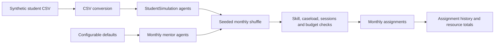
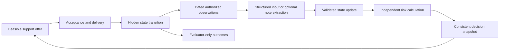

# Student support and school-dropout research

This project studies how to allocate limited student support fairly over time when
information about students is incomplete. The intended result is a reproducible
simulation benchmark comparing support policies, resource use, access and simulated
enrollment. It is a research project, not a deployed system for deciding real
students' eligibility or proof that mentoring prevents real school dropout.

**Current implementation:** typed student and mentor models plus a reproducible
12-month random-allocation baseline. The simulator loads synthetic student profiles
from CSV, creates configurable mentors, renews mentor capacity monthly, schedules
five tutoring sessions per selected student, permits selection again in later
months and charges per-session costs against one episode budget. Student-state
transitions, intervention effects, dropout outcomes, policy comparisons, risk
prediction and language-based feedback are not implemented.

Use [Guidance.md](Guidance.md) for function documentation and simple coding
conventions, [the roadmap](docs/roadmap.md) for development order, and
[the contract guide](docs/contracts.md) for interface boundaries. Update these
references and this README as each stage is implemented.

## Setup and run

Use **Python 3.12 or 3.13**. From the project folder, create an environment and
install the dependencies:

```sh
python3.12 -m venv .venv
source .venv/bin/activate
python -m pip install -r requirements.txt
python -m pip install -e .
python src/main.py
python -m unittest tests.test_school -v
```

No external service, model credentials or LLM is needed for the current baseline.
`src/main.py` executes the default simulation without writing output files.

The small agent-based allocation model can be run independently. By default it
loads a configurable number of student agents from
`data/synthetic/populations/synthetic_student_population.csv`. Constructor values
default to `src/utils/constants.py` and can be overridden, including the CSV path, or
callers can supply their own `Student` and `Mentor` objects:

```python
from src.models.school import School

school = School(
    num_students=20,
    num_mentors=3,
    num_months=12,
    students_per_mentor=5,
    sessions_per_student=5,
    mentor_cost_per_session=1,
    budget=1000,
    seed=42,
)
monthly_assignments = school.run_simulation()
```

Every month renews mentor capacity and assigns students up to each mentor's active
student and session limits. The default schedule runs for 12 months, assigns five
tutoring sessions per student per month, and returns assignments grouped by month.
Students are shuffled with a configurable seed each month; selection is unique
within a month, while students remain eligible to be selected again in later
months. Mentoring cost is charged per session against the total simulation budget;
session duration is not modeled. The synthetic profiles are scenario data, not
independent observations or evidence of intervention effectiveness.

With the current defaults, 10 mentors each receive 10 students per month. That
produces 100 assignments per month, 1,200 assignment records and 6,000 scheduled
sessions over 12 months. At one cost unit per session, 6,000 of the 10,000-unit
budget is spent. Exact student identities are reproducible for a given seed.

`monthly_assignments` has the shape `month -> {student_id: mentor_id}`. Detailed
records containing month, support type, session count and cost are retained in
`school.assignment_history`. `spent_budget`, `remaining_budget` and the mentors'
current caseloads expose resource use after a run.

## Repository structure

```text
src/main.py                 Minimal simulation entry point
pyproject.toml              Package metadata (legacy console target is not active)
data/
  processed/students/       Source-anchor profiles
  processed/splits/         Fixed split manifest
  synthetic/populations/    Supplied synthetic fixture
  synthetic/simulator_states/  Hidden reset parameters (environment only)
  external/                 Historical outcomes, reference tables, dictionary
src/
  utils/constants.py        Default horizon, capacity, cost, budget and seed
  models/student.py         Student profile and simulation-input records
  models/mentor.py          Mentor skills, monthly availability and caseload
  models/school.py          Monthly allocation orchestration and event history
  utils/school.py           Student loading and mentor-allocation helpers
tests/test_school.py         Allocation, cost and reproducibility checks
tests/test_student_models.py Legacy model-schema checks; see known issue below
docs/                       Architecture, roadmap and research specification
archive/                    Historical reports; not active implementation
Guidance.md                 Function guide and implementation conventions
```

See [architecture](docs/architecture.md) for current module responsibilities and
[the roadmap](docs/roadmap.md) for the next bounded increments.


## Dataset and interpretation

The existing generated CSVs are used directly. There is no builder, preprocessing
command or intermediate prepared copy. Original raw downloads are not required for
this workflow; repeating their provenance audit would require those inputs separately.

| File | Role |
| --- | --- |
| `synthetic_student_population.csv` | Fixed fixture: 2,000 generated rows, 1,200/400/400 train/validation/test |
| `student_dataset.csv` | 674 source anchors; primary cohort is 649 Portuguese-course profiles |
| `simulator_hidden_truth.csv` | Assumed reset parameters and evaluator-only static diagnostics |
| `student_outcomes_reference.csv` | Evaluator-only historical course outcomes |
| `subject_records_reference.csv` | 1,044 historical subject rows |
| `split_manifest.csv` | Retained anchor split assignments |

Higher-education tables and the variable dictionary remain reference material.
They are not pooled with the school cohort or exposed through the current table allowlist.
Supported cohorts are `fixture`, `primary` and `sensitivity` (all 674 anchors).
Supported splits are `train`, `validation` and `test`.

The school profiles come from two Portuguese schools, with ages 15–22. Synthetic
rows repeat source anchors and do not constitute independent observed students.
Preserve linkage-group splits for every descendant. Income, verified financial need
and observed school dropout are unknown; missing is not zero or false. Access
proxies are not verified poverty or official eligibility. Historical `G3 < 10`
means **course failure**, not school dropout. Attendance, engagement, financial
barriers, withdrawal dynamics and intervention effects are simulation assumptions.

`src.models.student` provides `Student` and `StudentSimulation` dataclasses for the
profile and synthetic simulation-input fields. `src.utils.school` converts the CSV
values before constructing those records. Internet, travel, disadvantage and
learning-gap proxies are computed properties rather than constructor parameters.

## Current data workflow



Selection is without replacement within a month. At the next month all students,
including previously selected students, return to the eligible random pool. Mentor
caseload and session capacity renew monthly; the total episode budget does not.

## Project specification

The following describes the intended complete system. The typed models and random
monthly allocation baseline above are implemented; student dynamics and outcome
evaluation remain planned. The detailed
[research specification](docs/CODEX_IMPLEMENTATION_PROMPT_v2.md) retains additional
acceptance cases; its old source paths and preparation stages are historical.
Current paths and development order are defined here and in the roadmap.

### Research questions and outputs

Compare how feasible allocation rules distribute scarce support and affect terminal
simulated enrollment. Study the tradeoff between access, expected benefit, resource
limits and incomplete observations. Later, measure how mentor-note extraction errors
propagate through estimated state, risk and allocation decisions.

Each experiment must output policy/scenario/seed identifiers, declared assumptions,
retention and withdrawal/re-entry outcomes, offers/acceptance/completion, waiting
time, resource use, fairness shortfalls and failed/infeasible runs. Keep extraction,
state/risk, allocation and simulated-effectiveness scorecards separate.

### Baselines and population sampling

Reproduce training-prevalence and simple logistic **course-failure** baselines.
Fit preprocessing on training data, select settings on validation, then freeze
before testing. Keep any higher-education exercise separate and preserve unresolved
Enrolled cases. Sample whole source profiles within their assigned split, retaining
anchor/group lineage. Use the existing synthetic table as a reproducible reset
fixture rather than pretending it is a new observed cohort.

### Simulation and support delivery

Begin with a small, language-free environment and usual-support control. Specify
weekly event order, horizon, enrollment/withdrawal/re-entry, stochastic transitions,
uptake, delays and explicit intervention-effect assumptions. Use simple seeded
randomness with separate streams for population, transitions, observations and ties;
never reveal future draws to policies. Calibrate/report simulated usual-support
retention without calling it an observed school-dropout rate. Include zero-effect
and harmful-effect scenarios.

Start with tutoring before adding liaison or transport assessment/referral. Model
offer, acceptance, delivery and completion separately. Reserve future staff time,
mentor caseload, money and administration capacity. Prevent double assignments,
negative budgets, overbooking and programmes extending beyond the episode without
an explicit carryover rule. Release unused commitments according to declared rules.

### Allocation, fairness and planning

Start with usual support, random feasible allocation and longest-waiting eligible
students. Add risk priority only when the corresponding validated score exists;
unavailable risk stays unavailable. Risk is not the same as incremental treatment
benefit. All ordinary policies receive equivalent information and resources.

Later compare estimated benefit allocation, constrained planning, access-constrained
planning and uncertainty-aware planning. Optimize endpoint enrollment relative to
the initial cohort. A shorter planning horizon needs a documented continuation-value
estimate. Validate small cases independently before claiming optimality.

Freeze eligible group/need cohorts at the start of each access window. Count unique
students offered appropriate support. Report explicit coverage shortfalls when
capacity prevents targets; never relax hard operational constraints. Unknown
eligibility stays unknown. Audit categories do not automatically become scoring
features, and minimum access does not guarantee equal outcomes.

### Observation, state and risk feedback

Only dated authorized observations and known intervention events update the
controller's estimated state. Keep hidden environment state separate. Validate,
deduplicate and replay observations deterministically, preserving evidence,
uncertainty, conflicts and source/receipt times. Late information must not rewrite
what an earlier decision knew. Qualitative improvement must not invent a numeric
attendance change; pending support must not count as delivered support.

A separate risk model scores the current estimate version. Define its simulated
withdrawal target, horizon and reference future-support regime before training on
training-world trajectories. Log model/calibration versions and availability; never
rename a historical course-failure score as simulated withdrawal risk.

Optional note extraction comes after structured feedback works. Extract only
supported facts and evidence spans; an LLM cannot directly assign risk, change the
simulator or invent intervention effects. Compare structured observations, extracted
notes, noisy/missing notes and a clearly labelled true-state diagnostic. A matched
note-content control is required to isolate extraction error. Add retrieval or
adaptation only for a measured need after simpler methods are evaluated.



This feedback loop is planned. At a decision cutoff, use only information already
available; observations of an action's later consequences belong to a later decision.

### Evaluation and reproducibility

Keep source-lineage and world-seed splits separate. Pair policy comparisons using
aligned exogenous randomness, retain all failed runs and freeze test settings.
Use episodes/worlds as independent Monte Carlo units and report paired differences
with uncertainty intervals; synthetic rows in a shared-capacity episode are not
independent experimental replicates. Evaluate sensitivity to effects, uptake,
delays, capacity, proxy definitions, horizons and structural assumptions.

Record input identities/hashes, seeds, configurations and model/policy versions with
experiment outputs. Validate leakage, lineage, unknowns, event timing, resource
accounting, replay and tiny-instance correctness as the relevant stages are built.
Simulation results describe the assumed worlds, not real-world causal effects.

## Stages and completion checks

| Stage | Status | Completion evidence required |
| --- | --- | --- |
| 1. Data foundation and exploration | Partial | Synthetic CSV loading and typed records work; legacy exploration artifacts exist but the earlier data-service layer is not active in this tree |
| 2. Baselines and profile sampling | Planned | Held-out course-failure metrics, within-split sampling and lineage checks |
| 3. Structured simulation | In progress | CSV-backed agents and reproducible monthly resource accounting work; state transitions and outcomes remain |
| 4. Allocation and evaluation | In progress | Random feasible allocation works; usual-support and rule-based comparisons remain |
| 5. Feedback and risk | Planned | Replayable state updates and independently validated simulated-risk scores |
| 6. Extended experiments | Planned | Fairness, alternative worlds, uncertainty and optional note-extraction comparisons |

The next simulation milestone is mutable monthly student state plus support-delivery
events: sessions completed, attendance/engagement transitions and clearly labelled
simulated withdrawal outcomes. After that, compare no-support, random and simple
rule-based policies. Structured observations should work before optional LLM note
extraction is introduced.

Current verification: all eight tests in `tests/test_school.py` pass, including
monthly capacity, support type, random repeat eligibility, budget limits and replay
with the same seed. Full test discovery still has one known legacy failure because
`tests/test_student_models.py` imports the old name `SyntheticStudent`, while the
current model is named `StudentSimulation`.
