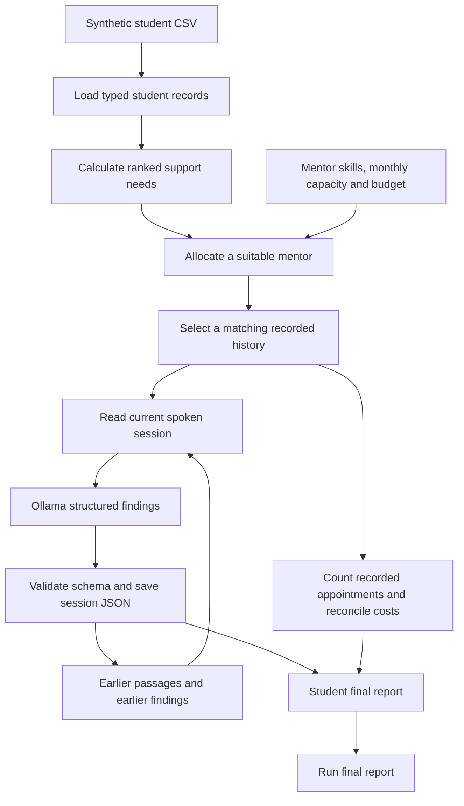

# Student support simulation

The working application loads synthetic student records, assigns mentors within skills,
capacity and budget limits, and processes recorded mentor–student conversations using
local Ollama. It saves structured session findings and final programme results.

There are two modes:

- **Interventions:** one mentor and one programme per student, with five planned
  appointments total by default. The highest support need selects a matching history.
- **Allocation only:** needs-based feasible assignments, with each student allocated
  once per run and mentors reusable in later months. No language model is used.

The active workflow has no analytics, participation scores, audit metadata, citation
handling, repair loops, or progress logs. Need severity remains because allocation uses it.
The teaching examples are separate from the application.

## Setup and commands

Use Python 3.12 or 3.13, as declared in `pyproject.toml`:

```bash
python3.12 -m venv .venv
source .venv/bin/activate
python -m pip install -r requirements.txt
python -m pip install --no-deps -e .
```

The requirements also include packages used by the preserved research notebooks.
SQLite FTS5 provides text retrieval; no embedding model is needed.

Start Ollama and install the default model:

```bash
ollama serve
# In another terminal:
ollama pull qwen3.5:latest
```

Run a small intervention programme:

```bash
python -m src.main --students 2 --mentors 1 --sessions 5
```

Equivalent entry points are `python src/main.py` and, after installation,
`school-dropout`. With no arguments, the CLI uses 10 students, 2 mentors, 12 allocation
months, 5 sessions per student, capacity 10, budget 10000, and seed 42.

```bash
# No Ollama needed:
python src/main.py --allocation-only --students 10 --mentors 2 --months 12

# A short intervention; the output directory must be new or empty:
python -m src.main --students 1 --mentors 1 --sessions 1 --output results/example

# Analyze one recorded history directly, through its second session:
python -m src.intervention.rag \
  01_transport_assessment/intervention_student_001 \
  --through-session 2 --output results/history/conclusion.json

# Offline feature tests:
python -m unittest discover -s tests
```

Use `--model` to select another installed model and `OLLAMA_BASE_URL` to change the
local service URL. The intervention CLI accepts `--history-root`, `--output`,
`--students`, `--mentors`, `--months`, `--sessions`, `--capacity`, `--budget`, and
`--seed`. It prints one final message. Model or configuration failures exit nonzero
with a short error. Individual extraction failures are also saved in final results.

## Complete working workflow



1. **Load students.** The loader reads the requested prefix of
   `data/synthetic/populations/synthetic_student_population.csv`. CSV values become
   `StudentSimulation` records. Missing optional values remain `None`; input files
   are never changed. Python callers can supply their own students and mentors.
2. **Calculate support needs.** Student properties compute current hypothetical
   needs. The highest severity chooses the support type; concern names break ties
   within one profile. Student priority ties use a seeded shuffle.
3. **Allocate mentors.** The school checks skills, caseload, session capacity, and
   remaining budget. It reserves the full planned programme dose. Generated mentors
   can provide all supported types; supplied mentors retain their own skills.
   `school.run_simulation()` creates the complete plan before
   `school.run_interventions(...)` processes it. Intervention does not reset or
   change allocations. Call `run_simulation()` explicitly to start a new run.
4. **Match a history.** A seeded choice selects a history from the corresponding
   support folder. Each student starts at most one programme per run and retains
   the assigned mentor. A missing history or unavailable resources leaves the
   student explicitly unassigned.
5. **Process sessions in order.** Only spoken Mentor/Student turns are loaded from
   Markdown. SQLite retrieves passages from the same history's earlier sessions.
   The current conversation and earlier validated findings go to the model.
   Dataset profiles, corpus header labels and future sessions stay outside prompts.
6. **Validate and save.** One model call generates each session's findings. One
   schema checks their structure before saving and adding them to memory. There
   are no automatic repairs. Invalid JSON, invalid findings, model failure, or
   prompt overflow stops that student's extraction and preserves earlier session
   files. Other students can continue.
7. **Reconcile and finish.** Actual recorded appointments determine attendance and
   cost, even when model processing fails. Unused reservations are refunded;
   refunds do not admit additional students or change the saved allocation plan.
   Student reports and the final run report are saved.

A programme fits within one allocation month; session duration and weekly state
transitions are not modeled. Capacity renews monthly. The allocation-only mode
charges the planned dose and does not claim that sessions were completed.

### Support rules

Severity is a scenario priority in `[0, 1]`, not a predicted dropout probability.
`learning_gap` is the grade shortfall below 10 divided by 10, using the average
anchor/math grade when math is available, and clipped to `[0, 1]`.

| Condition | Support | Severity |
| --- | --- | --- |
| Initially not enrolled | Reentry support | 1 |
| Learning gap or past failures | Tutoring | Maximum of learning gap and failures / 4, capped at 1 |
| Assumed attendance below 0.85 | Attendance planning | 1 − attendance |
| No home internet | Device access | 0.5 |
| Travel category at least 3 | Transport assessment | (category − 2) / 2 |
| Study-time category 1 | Homework support | 0.25 |
| Family relationship rating at most 2 | Family liaison | (3 − rating) / 3 |
| Health rating at most 2 | Wellbeing check-in | (3 − rating) / 3 |
| Assumed engagement below 0.6 | Peer support | 1 − engagement |
| Financial need explicitly verified | Family finances | 0.75 |
| No condition met | Routine tutoring check-in | 0 |

## Saved results

Default intervention output goes into a new directory under
`results/intervention_simulation/`. Student directory numbers are storage names;
JSON contains the actual student ID.

```text
run_.../
  final_report.json
  student_00001/
    session_01.json
    session_02.json
    final_report.json
```

A session file has this structure; `findings` contains the full structured result:

```json
{
  "student_id": "SYN00001",
  "mentor_id": "mentor_001",
  "session_number": 1,
  "findings": {"session_summary": "...", "primary_concern": "..."}
}
```

Findings include `session_summary`, `primary_concern`, `tracked_details`,
`intervention`, `outcome`, `session_helpful`, `next_steps`, `uncertainties`, and
`conclusion`. The schema is in `src/intervention/findings.py`. Validation checks
structure; it does not verify factual accuracy or causal claims.

| Result | Contents |
| --- | --- |
| Session | Student/mentor IDs, session number, findings |
| Student final | IDs, support type, planned/recorded sessions, status, assignment, final findings, error |
| Unassigned student | Student fields above, null assignment/conclusion, and `unassigned_reason` |
| Run final | Status, output directory, assignments, student results, spent and remaining budget |
| Standalone RAG | History ID, final session number, findings timeline, final conclusion |

Student status is `completed`, `incomplete`, `unassigned`, or `report_failed`.
Run status is `finished` or `failed`; unassigned or short programmes alone do not
mean extraction failure. A failed extraction has a null final conclusion; earlier
valid findings remain in session files. Existing output directories are protected
from accidental reuse. Existing historical results are not migrated.

## Code organization

Production classes have one file each. Examples and related enums remain grouped.

- `src/models/`: `Student`, `StudentSimulation`, `StudentInterventionProfile`,
  `Mentor`, `MentorAvailability`, `MentorAssignment`, and `School`, each in the
  matching snake-case module.
- `src/utils/school.py`: CSV conversion, mentor construction, and allocation checks.
- `src/intervention/`: separate `Session`, `Passage`, `SessionIndex`, `OllamaClient`,
  `InterventionRAG`, and `Intervention` modules. Plain functions handle transcript
  reading, findings validation, result writing, and cohort orchestration.
- `src/main.py`: command-line arguments and direct workflow execution.
- `src/basic_examples/`: independent agent, Markov, MDP, and CMDP demonstrations.
- `tests/`: small feature tests with a shared fake model; no live service required.

Classes own one responsibility, dependencies are passed explicitly, and the model
client can be replaced in tests. No abstract framework or scoring wrapper is used.
See [architecture](docs/architecture.md), [interfaces](docs/contracts.md), and
[implementation guidance](Guidance.md) for details.

## Teaching examples and research material

Run examples independently:

```bash
python -m src.basic_examples.markov_chains
python -m src.basic_examples.simple_agent
python -m src.basic_examples.agent_based_modelling
python -m src.basic_examples.markov_decision_process
python -m src.basic_examples.budgeted_mdp
python -m src.basic_examples.cmdp
```

Imports do not run simulations. Examples keep their essential state counts,
rewards, and optimization algorithms and print a final result. The CMDP example
uses SciPy through the existing scientific environment. The production workflow
uses a need-priority heuristic, not a CMDP optimizer.

The supplied CSVs and transcripts are used directly; no preprocessing command is
required. `data/processed/`, `data/external/`, notebooks, corpus generators, and
`archive/` remain research/reference material. Historical notebooks may need import
or result-field updates before reuse; they are outside this refactor. Historical
research specifications describe possible future work, not the active interface.

Synthetic conversations and assumed attendance/engagement are not observations of
real children or measured treatment effects. Missing appointments have unknown
reasons and do not establish dropout. Historical course failure is not school
dropout. Numeric outcome dynamics, trained risk models, policy evaluation, and
fairness experiments remain future work; see the [roadmap](docs/roadmap.md).
