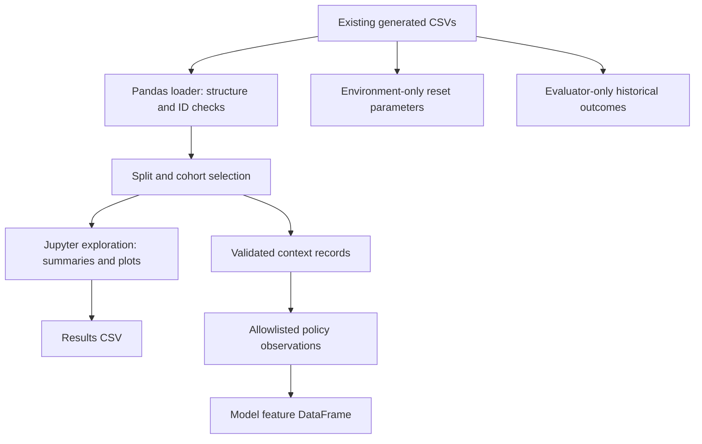
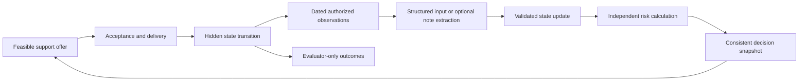

# Student support and school-dropout research

This project studies how to allocate limited student support fairly over time when
information about students is incomplete. The intended result is a reproducible
simulation benchmark comparing support policies, resource use, access and simulated
enrollment. It is a research project, not a deployed system for deciding real
students' eligibility or proof that mentoring prevents real school dropout.

**Current implementation:** a pandas-based data foundation, validated consumer
interfaces, Jupyter notebooks and a shared console/notebook runner. Baseline model fitting, population
sampling, simulation transitions, allocation, risk prediction and language-based
feedback are not implemented. Some of their data contracts already exist.

Use [Guidance.md](Guidance.md) for function documentation and simple coding
conventions, [the roadmap](docs/roadmap.md) for development order, and
[the contract guide](docs/contracts.md) for interface boundaries. Update these
references and this README as each stage is implemented.

## Setup and run

Use **Python 3.12 or 3.13** with the pinned pandas/NumPy versions. From the project
folder, create an environment and install the dependencies:

```sh
python3.12 -m venv .venv
source .venv/bin/activate
python -m pip install -r requirements.txt
python -m pip install -e .
python main.py summary
python main.py simulate --dry-run
python -m unittest discover -s tests -v
python -m notebook
```

Open `notebooks/01_data_exploration.ipynb` and restart the kernel/run all cells in
order. The notebook explains each step and writes only
`results/exploration/split_summary.csv`. Jupyter notebooks use their standard file
format internally; student data is read from CSV directly into pandas, without a
JSON loading or preparation step. No external service or model credentials are needed.

Libraries: pandas for reading/manipulating tables; NumPy for simple numerical
operations; Matplotlib for plotting; Jupyter Notebook for interactive exploration.
Use basic, readable operations rather than complex NumPy expressions.

```python
import pandas as pd
from src.data.dataset import population_table
from src.data.access import PolicyStore, model_features

# Raw research table: inspect and manipulate an independent in-memory copy.
students = population_table('train', cohort='primary')
students['age_years'] = pd.to_numeric(students['age_years'])
print(students.groupby('school_id')['age_years'].mean())

# Model inputs: use the allowlisted interface, not arbitrary raw-table columns.
records = PolicyStore().load_reset('train', cohort='primary')
features = pd.DataFrame([dict(model_features(record)) for record in records])
```

Loaders accept an optional dataset directory and default to `data/` (organized subdirectories; legacy flat CSV directories also work).
Raw tables preserve source strings and blanks. Convert required numeric columns
explicitly and use `pd.NA` for missing values in analysis copies. Typed consumer
records add domain validation; the raw DataFrame loader checks file structure/IDs.

## Repository structure

```text
main.py                     Console entry point (same functions as notebooks)
pyproject.toml              Editable installation and school-dropout command
configs/default.toml        Shared settings; paths relative to config file
data/
  processed/students/       Source-anchor profiles
  processed/splits/         Fixed split manifest
  synthetic/populations/    Supplied synthetic fixture
  synthetic/simulator_states/  Hidden reset parameters (environment only)
  external/                 Historical outcomes, reference tables, dictionary
notebooks/                  Ordered interactive research; see its README
src/
  cli.py                    Argument parsing and presentation
  data/                     Loading, consumer access and validated contracts
  experiments/runner.py     Shared orchestration returning pandas tables
tests/data/                 Data integrity, isolation and contract checks
tests/experiments/          Runner and entry-point checks
results/                    Ignored generated runs, tables, figures and logs
docs/                       Architecture, roadmap and research specification
archive/                    Historical reports; not active implementation
Guidance.md                 Function guide and implementation conventions
```

Most research work happens in notebooks; reusable operations belong in `src/`.
See [architecture](docs/architecture.md) for how the sample structure will grow.
TOML settings use Python's standard library, so configuration adds no dependency.
Install this checkout with `pip install -e .`; it keeps the code connected to its
local data/config files. Standalone wheel distribution is not supported yet.

```python
from src.experiments.runner import population_summary, run_simulation
summary = population_summary()
readiness = run_simulation(dry_run=True)
```

`python main.py`, `python -m src`, and the installed `school-dropout` command
share the same CLI. `simulate --config configs/default.toml --dry-run` validates
fixture/reset inputs and reports **zero executed steps**. Running `simulate`
without `--dry-run` exits with a clear error: the simulation engine is not yet
implemented. This structure prepares its entry point without inventing dynamics.


## Dataset and interpretation

The existing generated CSVs are used directly. There is no builder, preprocessing
command or intermediate prepared copy. Original raw downloads are not required for
this workflow; repeating their provenance audit would require those inputs separately.

| File | Role |
| --- | --- |
| `synthetic_student_population.csv` | Fixed fixture: 2,000 generated rows, 1,200/400/400 train/validation/test |
| `student_dataset.csv` | 674 source anchors; primary cohort is 649 Portuguese-course profiles |
| `simulator_hidden_truth.csv` | Assumed reset parameters and evaluator-only static diagnostics |
| `student_outcomes_reference.csv` | Evaluator-only historical course outcomes |
| `subject_records_reference.csv` | 1,044 historical subject rows |
| `split_manifest.csv` | Retained anchor split assignments |

Higher-education tables and the variable dictionary remain reference material.
They are not pooled with the school cohort or exposed through the current table allowlist.
Supported cohorts are `fixture`, `primary` and `sensitivity` (all 674 anchors).
Supported splits are `train`, `validation` and `test`.

The school profiles come from two Portuguese schools, with ages 15–22. Synthetic
rows repeat source anchors and do not constitute independent observed students.
Preserve linkage-group splits for every descendant. Income, verified financial need
and observed school dropout are unknown; missing is not zero or false. Access
proxies are not verified poverty or official eligibility. Historical `G3 < 10`
means **course failure**, not school dropout. Attendance, engagement, financial
barriers, withdrawal dynamics and intervention effects are simulation assumptions.

## Current data workflow



Raw research DataFrames may contain withheld fields. Ordinary policies use
`PolicyStore` and `model_features`; they cannot receive hidden parameters or late
outcomes through those interfaces. Default model features are first-period grade,
past failures and study-time category. Generated dynamic fields stay withheld until
an observation mechanism exists. These are application data-flow boundaries, not
an operating-system sandbox against arbitrary file reads.

## Project specification

The following describes the intended complete system. Only the data foundation and
exploration workflow above are implemented. The detailed
[research specification](docs/CODEX_IMPLEMENTATION_PROMPT_v2.md) retains additional
acceptance cases; its old source paths and preparation stages are historical.
Current paths and development order are defined here and in the roadmap.

### Research questions and outputs

Compare how feasible allocation rules distribute scarce support and affect terminal
simulated enrollment. Study the tradeoff between access, expected benefit, resource
limits and incomplete observations. Later, measure how mentor-note extraction errors
propagate through estimated state, risk and allocation decisions.

Each experiment must output policy/scenario/seed identifiers, declared assumptions,
retention and withdrawal/re-entry outcomes, offers/acceptance/completion, waiting
time, resource use, fairness shortfalls and failed/infeasible runs. Keep extraction,
state/risk, allocation and simulated-effectiveness scorecards separate.

### Baselines and population sampling

Reproduce training-prevalence and simple logistic **course-failure** baselines.
Fit preprocessing on training data, select settings on validation, then freeze
before testing. Keep any higher-education exercise separate and preserve unresolved
Enrolled cases. Sample whole source profiles within their assigned split, retaining
anchor/group lineage. Use the existing synthetic table as a reproducible reset
fixture rather than pretending it is a new observed cohort.

### Simulation and support delivery

Begin with a small, language-free environment and usual-support control. Specify
weekly event order, horizon, enrollment/withdrawal/re-entry, stochastic transitions,
uptake, delays and explicit intervention-effect assumptions. Use simple seeded
randomness with separate streams for population, transitions, observations and ties;
never reveal future draws to policies. Calibrate/report simulated usual-support
retention without calling it an observed school-dropout rate. Include zero-effect
and harmful-effect scenarios.

Start with tutoring before adding liaison or transport assessment/referral. Model
offer, acceptance, delivery and completion separately. Reserve future staff time,
mentor caseload, money and administration capacity. Prevent double assignments,
negative budgets, overbooking and programmes extending beyond the episode without
an explicit carryover rule. Release unused commitments according to declared rules.

### Allocation, fairness and planning

Start with usual support, random feasible allocation and longest-waiting eligible
students. Add risk priority only when the corresponding validated score exists;
unavailable risk stays unavailable. Risk is not the same as incremental treatment
benefit. All ordinary policies receive equivalent information and resources.

Later compare estimated benefit allocation, constrained planning, access-constrained
planning and uncertainty-aware planning. Optimize endpoint enrollment relative to
the initial cohort. A shorter planning horizon needs a documented continuation-value
estimate. Validate small cases independently before claiming optimality.

Freeze eligible group/need cohorts at the start of each access window. Count unique
students offered appropriate support. Report explicit coverage shortfalls when
capacity prevents targets; never relax hard operational constraints. Unknown
eligibility stays unknown. Audit categories do not automatically become scoring
features, and minimum access does not guarantee equal outcomes.

### Observation, state and risk feedback

Only dated authorized observations and known intervention events update the
controller's estimated state. Keep hidden environment state separate. Validate,
deduplicate and replay observations deterministically, preserving evidence,
uncertainty, conflicts and source/receipt times. Late information must not rewrite
what an earlier decision knew. Qualitative improvement must not invent a numeric
attendance change; pending support must not count as delivered support.

A separate risk model scores the current estimate version. Define its simulated
withdrawal target, horizon and reference future-support regime before training on
training-world trajectories. Log model/calibration versions and availability; never
rename a historical course-failure score as simulated withdrawal risk.

Optional note extraction comes after structured feedback works. Extract only
supported facts and evidence spans; an LLM cannot directly assign risk, change the
simulator or invent intervention effects. Compare structured observations, extracted
notes, noisy/missing notes and a clearly labelled true-state diagnostic. A matched
note-content control is required to isolate extraction error. Add retrieval or
adaptation only for a measured need after simpler methods are evaluated.



This feedback loop is planned. At a decision cutoff, use only information already
available; observations of an action's later consequences belong to a later decision.

### Evaluation and reproducibility

Keep source-lineage and world-seed splits separate. Pair policy comparisons using
aligned exogenous randomness, retain all failed runs and freeze test settings.
Use episodes/worlds as independent Monte Carlo units and report paired differences
with uncertainty intervals; synthetic rows in a shared-capacity episode are not
independent experimental replicates. Evaluate sensitivity to effects, uptake,
delays, capacity, proxy definitions, horizons and structural assumptions.

Record input identities/hashes, seeds, configurations and model/policy versions with
experiment outputs. Validate leakage, lineage, unknowns, event timing, resource
accounting, replay and tiny-instance correctness as the relevant stages are built.
Simulation results describe the assumed worlds, not real-world causal effects.

## Stages and completion checks

| Stage | Status | Completion evidence required |
| --- | --- | --- |
| 1. Data foundation and exploration | Implemented | Population summary, data/contract tests and fresh-kernel notebook execution |
| 2. Baselines and profile sampling | Next | Held-out course-failure metrics, within-split sampling and lineage checks |
| 3. Structured simulation | Planned | Event-order, reproducibility, zero-effect and capacity checks |
| 4. Allocation and evaluation | Planned | Feasible baseline comparisons on frozen held-out settings |
| 5. Feedback and risk | Planned | Replayable state updates and independently validated simulated-risk scores |
| 6. Extended experiments | Planned | Fairness, alternative worlds, uncertainty and optional note-extraction comparisons |

The first simulation milestone is a reproducible table comparing usual support and
simple policies on retention, access and resource use, including a zero-effect
control. Historical artifacts in `archive/` do not demonstrate that current code or
future stages have run. With every completed increment, update this status table,
run instructions, diagrams, Guidance.md and the roadmap.

Reorganization verified with Python 3.12 and the pinned project dependencies:
all 26 tests passed, all nine moved CSV hashes matched, and both notebooks ran
in fresh kernels. Both exploration plots were inspected. Editable installation,
`main.py`, `python -m src`, and the installed console command were checked.
Executed notebooks and plots are saved under `results/verification/`.
