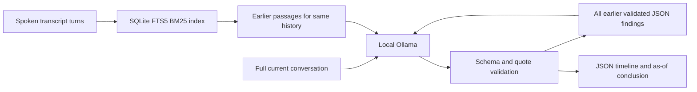
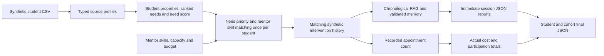
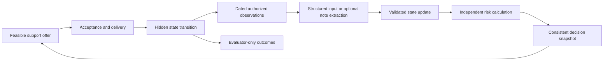

# Student support and school-dropout research

This project studies how to allocate limited student support fairly over time when
information about students is incomplete. The intended result is a reproducible
simulation benchmark comparing support policies, resource use, access and simulated
enrollment. It is a research project, not a deployed system for deciding real
students' eligibility or proof that mentoring prevents real school dropout.

**Current implementation:** typed CSV-backed students, configurable mentors, the
original monthly random-allocation baseline, and a feature-matched intervention
simulation using the existing local Ollama RAG pipeline. Intervention mode creates
an initial profile and transparent support-priority scores, assigns one mentor and
one synthetic history per student, and saves validated JSON after every recorded
session plus student and cohort final reports. Each student has **five planned
sessions total** by default, with no second programme in later months. A source
history may record fewer appointments. Numeric treatment effects, school-dropout
prediction and retention dynamics remain unimplemented.

Use [Guidance.md](Guidance.md) for function documentation and simple coding
conventions, [the roadmap](docs/roadmap.md) for development order, and
[the contract guide](docs/contracts.md) for interface boundaries. Update these
references and this README as each stage is implemented.

## Setup and run

Use **Python 3.12 or 3.13**. From the project folder, create an environment and
install the dependencies:

```sh
python3.12 -m venv .venv
source .venv/bin/activate
python -m pip install -r requirements.txt
python -m pip install -e .
python -m unittest discover -s tests -v
```

The default command runs a small **10-student, 2-mentor** intervention example.
Start local Ollama with `qwen3.5:latest` installed first:

```sh
ollama pull qwen3.5:latest
python src/main.py --students 2 --mentors 1 --seed 7
python -m unittest discover -s tests -v
```

Reports go to a new timestamped folder under `results/intervention_simulation/`.
`--output` selects a new or empty directory; previous reports are protected from
overwriting. `--model`, `--sessions`, `--months`, `--capacity`, `--budget`, `--seed`
and `--history-root` configure the run. `OLLAMA_BASE_URL` changes the local endpoint.
No new dependencies are needed beyond the existing RAG requirements.

The original language-free monthly baseline is still available:

```sh
python src/main.py --allocation-only --students 1000 --mentors 10
```

The small agent-based allocation model can be run independently. By default it
loads a configurable number of student agents from
`data/synthetic/populations/synthetic_student_population.csv`. Constructor values
default to `src/utils/constants.py` and can be overridden, including the CSV path, or
callers can supply their own `Student` and `Mentor` objects:

```python
from src.models.school import School

school = School(
    num_students=20,
    num_mentors=3,
    num_months=12,
    students_per_mentor=5,
    sessions_per_student=5,
    mentor_cost_per_session=1,
    budget=1000,
    seed=42,
)
monthly_assignments = school.run_simulation()
```

Every month renews mentor capacity and assigns students up to each mentor's active
student and session limits. The default schedule runs for 12 months, assigns five
tutoring sessions per student per month, and returns assignments grouped by month.
Students are shuffled with a configurable seed each month; selection is unique
within a month, while students remain eligible to be selected again in later
months. Mentoring cost is charged per session against the total simulation budget;
session duration is not modeled. The synthetic profiles are scenario data, not
independent observations or evidence of intervention effectiveness.

With the current defaults, 10 mentors each receive 10 students per month. That
produces 100 assignments per month, 1,200 assignment records and 6,000 scheduled
sessions over 12 months. At one cost unit per session, 6,000 of the 10,000-unit
budget is spent. Exact student identities are reproducible for a given seed.

`monthly_assignments` has the shape `month -> {student_id: mentor_id}`. Detailed
records containing month, support type, session count and cost are retained in
`school.assignment_history`. `spent_budget`, `remaining_budget` and the mentors'
current caseloads expose resource use after a run.

### Feature-matched intervention simulation

```python
from src.models.school import School

school = School(num_students=10, num_mentors=2, seed=42)
report = school.run_interventions()  # Uses the existing local Ollama client.
profiles = school.intervention_profiles
```

`School.run_simulation()` retains the original monthly allocation behavior above.
`School.run_interventions()` starts a fresh run, prioritizes higher student need
scores, and uses seeded shuffling to break equal-score ties. Mentor skills, monthly
capacity and episode budget remain hard constraints. Each admitted student retains
one mentor throughout their programme and is excluded from all later allocations.
Caller-supplied initial mentor assignments are honored when feasible. Generated
mentors are assumed generalists across the 13 support types; custom mentor skills
remain hard constraints. Students without feasible resources get an explicit
unassigned report. Allocation months are admission windows: all appointments of a
programme are replayed within its assigned window, without modeling session duration.

`Student.need_profile` computes ranked needs from the student properties.
`Student.need_score` is the maximum severity and `Student.primary_support_type`
selects the highest-ranked need. These computed properties recalculate when source
properties change and are not additional CSV or constructor fields.
`Student.initial_scores` supplies the numeric score snapshot.
`create_profile(student)` copies these into a programme report with the source fields and initial learning gap,
assumed attendance, assumed engagement and support priority. Missing values remain
unknown, including financial need and school-dropout risk. The highest-severity
feature rule chooses the support type; ties use the problem name. These are
**declared hypothetical scenario rules**, not observed diagnoses or a trained risk
model. Dataset inputs and scores are not changed by language-model findings.

| Dataset feature / threshold | Simulated concern / support |
| --- | --- |
| Initially not enrolled (assumed) | Return to learning / reentry support |
| Learning gap > 0 or prior course failures | Learning gap / tutoring |
| Assumed attendance < 0.85 | Attendance routine / attendance planning |
| No home internet | Digital access / device access; ownership remains unknown |
| Travel category >= 3 | Long journey / transport assessment; entitlement remains unknown |
| Study-time category = 1 | Study routine / homework support |
| Family relationship rating <= 2 | Family communication / family liaison |
| Self-rated health <= 2 | Wellbeing check-in; no diagnosis inferred |
| Assumed engagement < 0.6 | Participation opportunities / peer support; isolation remains unknown |
| Verified financial need = true | Family finances |
| No threshold met | Routine learning check-in / tutoring |

Severity formulas are in `src/models/student.py`.
The learning-gap calculation uses the available anchor and math grades. Support
priority is the maximum problem severity in [0, 1], never a dropout probability.
The rules retain their existing thresholds and weights; the allocation policy is
reported as `need_priority_seeded_ties`. This is a feasible priority heuristic;
a CMDP optimizer, transition model and estimated treatment benefit remain planned.
`School.step(month, prioritize_by_need=True)` also enables need priority and
student-specific support matching without running RAG. Explicit per-student or
shared support requests override the derived support type. The default
`School.step()` and `run_simulation()` keep the monthly random tutoring baseline.
No poverty, hunger, language need or learning disability is inferred from proxies.

A separate seeded draw selects one history within the primary support type from
`student_mentor_intervention_histories`. The simulator **replays existing spoken
conversations**; it does not generate personalized dialogue. A history can be
reused for different simulated students. Dataset-derived concerns remain separate
from transcript-reported details, and secondary concerns are retained in reports.
The number of source appointments defines simulated participation: the corpus has
one to five recorded appointments per history. Missing appointments have unknown
reasons and never establish school dropout. Retrospective CSV labels and future
sessions are excluded from RAG prompts.

`Intervention` in `src/intervention/intervention.py` now organizes each assigned
student–mentor programme. The simulator creates it with the shared RAG service,
student profile, student output folder and allocation month, then calls
`start_intervention(student, mentor)`. It verifies the pair, runs the initial and
follow-up sessions in one chronological pass, writes each validated session, and
returns the student's final report. The simulator reconciles actual attendance,
adds assignment accounting, saves the student final JSON and aggregates the cohort.
A started profile cannot be run again; a fresh simulation creates fresh profiles.
The first session starts with empty memory; subsequent sessions receive earlier
validated findings and retrieved evidence through the same RAG call.

Whole programmes reserve session capacity and budget at admission. After replay,
only recorded appointments are charged and unused reservations are released for
later admission windows. `MentorAssignment.sessions` is the planned dose;
`completed_sessions` is recorded attendance and `cost_units` is its actual cost.
The allocation-only baseline continues charging all scheduled appointments.

Each run writes:

```text
results/intervention_simulation/run_<timestamp>/
  final_report.json                 Cohort summary, configuration, assignments and students
  student_00001/
    session_01.json                 Profile, scores, concerns, spoken turns, validated findings
    session_02.json                 Earlier-memory retrieval and citation provenance included
    final_report.json               Final as-of conclusion and programme participation
```

Student folders use safe sequence numbers; every report includes the original
student ID, mentor ID and full source history ID. Session reports are saved as soon
as validation succeeds. One chronological RAG pass carries earlier validated memory
forward, without repeated LLM calls for previous sessions. Final reports distinguish
`completed`, `incomplete`, `unassigned` and `report_failed`; completed means the
planned appointment count was recorded, not that a barrier was resolved. Extraction
failures preserve earlier validated reports, mark the cohort run failed and cause
the CLI to exit nonzero. An unvalidated final conclusion is never substituted.

`SchoolCMDPEnvironment.run_interventions()` also records a participation score:
recorded appointments / planned appointments for the whole cohort, including
unassigned students. This is not a retention, risk or treatment-benefit score.
The wrapper remains a constrained simulation coordinator, not an optimized CMDP.

### Longitudinal intervention RAG

[intervention_rag.ipynb](notebooks/intervention_rag.ipynb) extends the single-session
[reference notebook](notebooks/intervention_session_conclusion.ipynb). It reads the
390 conversations under `src/intervention/student_mentor_intervention_histories`
and keeps each of the 130 histories separate using its full relative folder path.
Student folder names alone are not unique across intervention types.

Install the project requirements, start local Ollama, and install the default model:

```sh
ollama pull qwen3.5:latest
python -m src.intervention.rag \
  01_transport_assessment/intervention_student_003 \
  --through-session 3 \
  --output results/intervention_rag/transport_through_3.json
python -m unittest tests.test_intervention_rag -v
```

Use the notebook to inspect retrieval, choose a student, change the cutoff or ask
a history question. `OLLAMA_BASE_URL` overrides the default local endpoint.
`--root` accepts another transcript collection with the same directory layout and
`**Mentor:**` / `**Student:**` paragraphs; no CSV manifest is needed.



Each recorded session is processed in order. Earlier calls cannot access later
conversations. BM25 retrieves passages separately from every earlier session;
validated JSON memory carries pending actions and evidence forward. Only spoken
turns are used: CSV retrospective labels and Markdown classification headers never
enter prompts. Rebuild the index and replay after adding or editing transcripts.
The SQLite database stores passages; saved JSON stores the memory timeline, spoken-text
hashes and retrieval provenance. Each run replays the selected history rather than
reusing potentially stale generated summaries.

Output includes `tracked_details`, intervention status/delivery, observed outcomes,
session helpfulness, intervention helpfulness, next steps, uncertainties and exact
session-numbered evidence. Delivery can be `null` when unknown. A pending request
cannot establish delivered support or helpful intervention outcomes. Reported
unresolved barriers can still be recorded without claiming a causal effect.
Invalid generations receive at most two repair attempts; rejected responses never
enter memory. Validation failures remain in the audit timeline, and exhausted
attempts raise an error rather than saving an unvalidated conclusion.

This is lexical retrieval, not embedding similarity search. Context is bounded by
an explicit character budget; overflow raises an error. The model selects prompt-scoped evidence IDs; Python resolves them to exact
source words and session numbers before validating the public report schema.
This prevents merged utterances and punctuation changes from corrupting quotes.
Schema and verbatim checks cannot verify whether a quote actually supports the model's interpretation. Review
conclusions and evaluate independently authored histories before research use.
Missing appointments never establish dropout, and synthetic changes are not causal
effect estimates. Intervention mode uses this extraction pipeline without numeric state/risk feedback.

## Repository structure

```text
src/main.py                 Intervention CLI, allocation-only option and CMDP coordinator
pyproject.toml              Package metadata (legacy console target is not active)
data/
  processed/students/       Source-anchor profiles
  processed/splits/         Fixed split manifest
  synthetic/populations/    Supplied synthetic fixture
  synthetic/simulator_states/  Hidden reset parameters (environment only)
  external/                 Historical outcomes, reference tables, dictionary
src/
  utils/constants.py        Shared defaults, paths, schemas and scenario constants
  utils/enums.py            Shared categorical types and example state/action enums
  models/student.py         Source records, computed needs and intervention profiles
  models/mentor.py          Support skills, availability and caseload
  models/school.py          Allocation, programme reservations and actual-session costs
  intervention/simulation.py Profile snapshots, history assignment, accounting and reports
  intervention/intervention.py Student–mentor programme lifecycle and session reports
  intervention/student_mentor_dialogues/  Synthetic reference corpus and metadata
  intervention/rag.py       Student-scoped retrieval, chronological memory and JSON extraction
  intervention/student_mentor_intervention_histories/  Synthetic longitudinal sessions
  utils/school.py           Student loading and mentor-allocation helpers
tests/test_school.py         Allocation, cost and reproducibility checks
tests/test_intervention_rag.py Retrieval isolation, memory, evidence and output checks
tests/test_intervention_simulation.py Feature matching, participation, resources and reports
tests/test_student_models.py CSV-schema and derived-property checks
docs/                       Architecture, roadmap and research specification
archive/                    Historical reports; not active implementation
Guidance.md                 Function guide and implementation conventions
```

See [architecture](docs/architecture.md) for current module responsibilities and
[the roadmap](docs/roadmap.md) for the next bounded increments.


## Dataset and interpretation

The existing generated CSVs are used directly. There is no builder, preprocessing
command or intermediate prepared copy. Original raw downloads are not required for
this workflow; repeating their provenance audit would require those inputs separately.

| File | Role |
| --- | --- |
| `synthetic_student_population.csv` | Fixed fixture: 2,000 generated rows, 1,200/400/400 train/validation/test |
| `student_dataset.csv` | 674 source anchors; primary cohort is 649 Portuguese-course profiles |
| `simulator_hidden_truth.csv` | Assumed reset parameters and evaluator-only static diagnostics |
| `student_outcomes_reference.csv` | Evaluator-only historical course outcomes |
| `subject_records_reference.csv` | 1,044 historical subject rows |
| `split_manifest.csv` | Retained anchor split assignments |
| `src/intervention/student_mentor_dialogues/manifest.csv` | Separate synthetic single-session reference material |

Higher-education tables and the variable dictionary remain reference material.
They are not pooled with the school cohort or exposed through the current simulation loader.
Supported cohorts are `fixture`, `primary` and `sensitivity` (all 674 anchors).
Supported splits are `train`, `validation` and `test`.

The school profiles come from two Portuguese schools, with ages 15–22. Synthetic
rows repeat source anchors and do not constitute independent observed students.
Preserve linkage-group splits for every descendant. Income, verified financial need
and observed school dropout are unknown; missing is not zero or false. Access
proxies are not verified poverty or official eligibility. Historical `G3 < 10`
means **course failure**, not school dropout. Attendance, engagement, financial
barriers, withdrawal dynamics and intervention effects are simulation assumptions.

`src.models.student` provides `Student` and `StudentSimulation` dataclasses for the
profile and synthetic simulation-input fields. `src.utils.school` converts the CSV
values before constructing those records. Internet, travel, disadvantage and
learning-gap proxies are computed properties rather than constructor parameters.

## Current data workflow



The allocation-only baseline independently renews eligibility each month. The
intervention mode excludes students after their first programme. Both respect
mentor capacities and one episode budget.

## Project specification

The following describes the intended complete system. The typed models and random
monthly allocation baseline and feature-matched RAG replay above are implemented; student dynamics and outcome
evaluation remain planned. The detailed
[research specification](docs/CODEX_IMPLEMENTATION_PROMPT_v2.md) retains additional
acceptance cases; its old source paths and preparation stages are historical.
Current paths and development order are defined here and in the roadmap.

### Research questions and outputs

Compare how feasible allocation rules distribute scarce support and affect terminal
simulated enrollment. Study the tradeoff between access, expected benefit, resource
limits and incomplete observations. Later, measure how mentor-note extraction errors
propagate through estimated state, risk and allocation decisions.

Each experiment must output policy/scenario/seed identifiers, declared assumptions,
retention and withdrawal/re-entry outcomes, offers/acceptance/completion, waiting
time, resource use, fairness shortfalls and failed/infeasible runs. Keep extraction,
state/risk, allocation and simulated-effectiveness scorecards separate.

### Baselines and population sampling

Reproduce training-prevalence and simple logistic **course-failure** baselines.
Fit preprocessing on training data, select settings on validation, then freeze
before testing. Keep any higher-education exercise separate and preserve unresolved
Enrolled cases. Sample whole source profiles within their assigned split, retaining
anchor/group lineage. Use the existing synthetic table as a reproducible reset
fixture rather than pretending it is a new observed cohort.

### Simulation and support delivery

Begin with a small, language-free environment and usual-support control. Specify
weekly event order, horizon, enrollment/withdrawal/re-entry, stochastic transitions,
uptake, delays and explicit intervention-effect assumptions. Use simple seeded
randomness with separate streams for population, transitions, observations and ties;
never reveal future draws to policies. Calibrate/report simulated usual-support
retention without calling it an observed school-dropout rate. Include zero-effect
and harmful-effect scenarios.

Start with tutoring before adding liaison or transport assessment/referral. Model
offer, acceptance, delivery and completion separately. Reserve future staff time,
mentor caseload, money and administration capacity. Prevent double assignments,
negative budgets, overbooking and programmes extending beyond the episode without
an explicit carryover rule. Release unused commitments according to declared rules.

### Allocation, fairness and planning

Start with usual support, random feasible allocation and longest-waiting eligible
students. Add risk priority only when the corresponding validated score exists;
unavailable risk stays unavailable. Risk is not the same as incremental treatment
benefit. All ordinary policies receive equivalent information and resources.

Later compare estimated benefit allocation, constrained planning, access-constrained
planning and uncertainty-aware planning. Optimize endpoint enrollment relative to
the initial cohort. A shorter planning horizon needs a documented continuation-value
estimate. Validate small cases independently before claiming optimality.

Freeze eligible group/need cohorts at the start of each access window. Count unique
students offered appropriate support. Report explicit coverage shortfalls when
capacity prevents targets; never relax hard operational constraints. Unknown
eligibility stays unknown. Audit categories do not automatically become scoring
features, and minimum access does not guarantee equal outcomes.

### Observation, state and risk feedback

Only dated authorized observations and known intervention events update the
controller's estimated state. Keep hidden environment state separate. Validate,
deduplicate and replay observations deterministically, preserving evidence,
uncertainty, conflicts and source/receipt times. Late information must not rewrite
what an earlier decision knew. Qualitative improvement must not invent a numeric
attendance change; pending support must not count as delivered support.

A separate risk model scores the current estimate version. Define its simulated
withdrawal target, horizon and reference future-support regime before training on
training-world trajectories. Log model/calibration versions and availability; never
rename a historical course-failure score as simulated withdrawal risk.

Optional note extraction comes after structured feedback works. Extract only
supported facts and evidence spans; an LLM cannot directly assign risk, change the
simulator or invent intervention effects. Compare structured observations, extracted
notes, noisy/missing notes and a clearly labelled true-state diagnostic. A matched
note-content control is required to isolate extraction error. Add retrieval or
adaptation only for a measured need after simpler methods are evaluated.



This feedback loop is planned. At a decision cutoff, use only information already
available; observations of an action's later consequences belong to a later decision.

### Evaluation and reproducibility

Keep source-lineage and world-seed splits separate. Pair policy comparisons using
aligned exogenous randomness, retain all failed runs and freeze test settings.
Use episodes/worlds as independent Monte Carlo units and report paired differences
with uncertainty intervals; synthetic rows in a shared-capacity episode are not
independent experimental replicates. Evaluate sensitivity to effects, uptake,
delays, capacity, proxy definitions, horizons and structural assumptions.

Record input identities/hashes, seeds, configurations and model/policy versions with
experiment outputs. Validate leakage, lineage, unknowns, event timing, resource
accounting, replay and tiny-instance correctness as the relevant stages are built.
Simulation results describe the assumed worlds, not real-world causal effects.

## Stages and completion checks

| Stage | Status | Completion evidence required |
| --- | --- | --- |
| 1. Data foundation and exploration | Partial | Synthetic CSV loading and typed records work; legacy exploration artifacts exist but the earlier data-service layer is not active in this tree |
| 2. Baselines and profile sampling | Planned | Held-out course-failure metrics, within-split sampling and lineage checks |
| 3. Structured simulation | In progress | CSV-backed agents and reproducible monthly resource accounting work; state transitions and outcomes remain |
| 4. Allocation and evaluation | In progress | Random baseline and need-priority feasible allocation work; outcome comparisons remain |
| 5. Feedback and risk | Planned | Replayable state updates and independently validated simulated-risk scores |
| 6. Extended experiments | Planned | Fairness, alternative worlds, uncertainty and optional note-extraction comparisons |

The next simulation milestone is dated structured observations and explicit numeric
state transitions, followed by no-support and rule-based policy comparisons. The
current feature-matched replay produces evidence-backed qualitative reports and
participation counts, without inventing intervention effects or dropout outcomes.

Current verification: all 40 tests pass under `python -m unittest discover -s tests -v`.
They cover source models, baseline allocation, RAG chronology/provenance, feature
rules, computed needs, scarce-budget need priority, specialist matching, five-session total doses, incomplete participation, actual cost accounting,
mentor continuity, resource shortfalls, repeat runs, immediate session persistence,
extraction failures and the CMDP participation score.

The two-student local Ollama smoke run (`--students 2 --mentors 1 --seed 7`) also
completed end to end with `qwen3.5:latest`: one five-session programme, one
one-session incomplete programme, six validated session reports, no citation
repairs and six mentoring cost units. The saved cohort artifact is
`results/intervention_simulation/evidence_ids_seed_7/final_report.json` (generated
results are git-ignored). This verifies replay/reporting, not semantic extraction
accuracy or intervention effectiveness.
