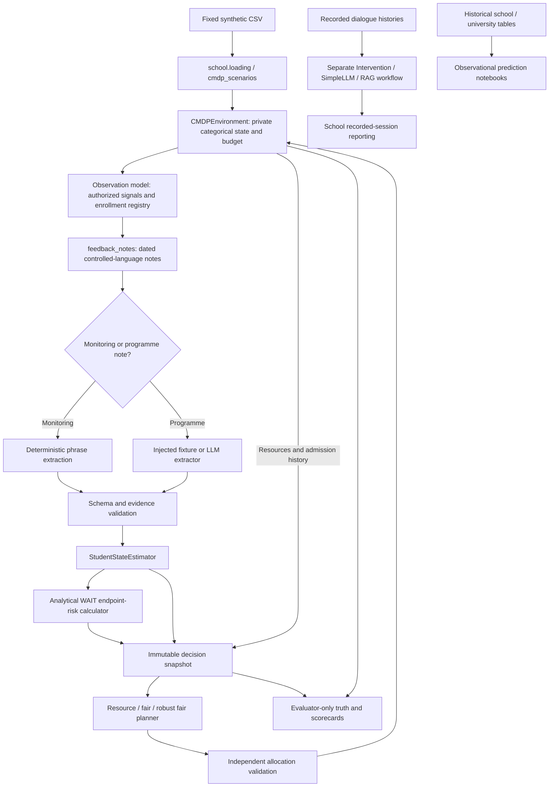

# Research implementation and plan-compliance audit

**Date:** 8 November 2026. **Revision:** `7eb519d18ef0e1fe6be0ab2dc2c7b89d5cd05317`. **Disposition: PARTIALLY — a functioning synthetic benchmark, insufficient for the complete research question.**

This is an audit, not a repair. No implementation, test, dataset or existing result was changed. The current offline suite was executed: **231 tests passed in 58.302 seconds**. Additional bounded probes exercised actual interfaces without a live model or expensive training. Their limitations are recorded below.

## A. Executive assessment and scope

The implementation **does not fully match the v2 plan**. Its strongest completed capability is a discrete, monthly, single-programme allocation benchmark with hard realized budget/capacity checks, rolling fairness optimization, qualitative observation filtering and synthetic risk calculations. It runs from reset to terminal evaluation. A narrower research experiment has also been executed historically. These facts do not establish completion of the original sequential delivery or language-feedback research gates.

| Question | Assessment |
|---|---|
| Most advanced work genuinely demonstrated | End-to-end observation/filter/optimizer integration and historical paired robust-versus-point experiments. Original v2 Stage 7 is partial; earlier Stage 3–4 delivery and Stage 2 population requirements remain incomplete. There is no defensible claim that every stage through Stage 7 is complete. |
| Simulator runs end to end? | Yes, the discrete monthly world, including four-round audit probes and the offline suite. A continuous hazard world and re-entry are absent from the active benchmark. |
| Resources enforced? | Yes for indivisible five-appointment admissions, individual mentor compatibility, per-month admission/appointment limits and remaining episode money. No session-calendar, staff-hour, uptake or future-delivery commitment enforcement exists in this world. |
| Fairness enforced? | Yes, a mathematical minimum-admission-coverage target with explicit shortfall and hard resources. It is not the planned four-week offer metric, nor guaranteed outcome parity. |
| Note-to-allocation loop complete? | Structured monitoring can alter later allocations. **Injected LLM extraction cannot currently influence an actionable student's later allocation**, because it processes only post-admission programme notes and each student is permanently excluded after admission. |
| Results reproducible? | Partially. Seeds, traces and some caches work, but replay drops supported settings, amendments overwrite freeze records, saved results reference different source contents, and the tested interpreter is outside the declared range. |
| Scientific conclusions supported? | Narrow synthetic conclusions only. Saved primary retention differences do not establish robust-planner superiority. No current result answers the full question about mentor-note extraction errors, population generalization and realistic support delivery. |

### Reference precedence

Reviewed the [v2 implementation prompt](/Users/shuniy/Documents/projects/school-dropout/docs/CODEX_IMPLEMENTATION_PROMPT_v2.md:40), [research plan](/Users/shuniy/Documents/projects/school-dropout/docs/references/school_dropout_research_plan.md:1), and [original research project document](</Users/shuniy/Documents/projects/school-dropout/docs/Research Project on Student Dropout.md>), together with the current contracts, architecture, assumptions, CMDP/feedback specifications, protocol and stored acceptance records. The original project document contains RTF-formatted content despite its `.md` suffix. All three requested references are present.

**V2 takes precedence for compliance.** Later documents deliberately narrow the world to monthly categorical dynamics and automatic completion. Those choices explain departures; they do not supersede v2 for this review. A missing richer world is a scope gap, not proof that the existing Markov transition equations are wrong. This report expands the [earlier review](/Users/shuniy/Documents/projects/school-dropout/docs/implementation_review_2026-11-08.md), particularly on data, original-plan requirements and the reset-information boundary.

### Architecture actually present



The active entry point is [src.main.main](/Users/shuniy/Documents/projects/school-dropout/src/main.py:53); its comparison runner joins oracle baseline runs and feedback planner runs. [School.run_cmdp_feedback](/Users/shuniy/Documents/projects/school-dropout/src/school/school.py:314) wraps the controller. The separate [School.run_simulation](/Users/shuniy/Documents/projects/school-dropout/src/school/school.py:265) / [simulation.run_simulation](/Users/shuniy/Documents/projects/school-dropout/src/school/simulation.py:10) workflow analyzes recorded intervention histories; it is not the stochastic transition engine. [performance.apply_outcomes](/Users/shuniy/Documents/projects/school-dropout/src/school/performance.py:35) records reported categorical outcomes without inventing numeric grade/attendance improvements.

Prediction notebooks, the archived dataset package and `src/basic_examples/` are disconnected from the active dynamic risk calculation. There is no current `src/data/` or `src/models/` package; equivalent runtime functionality is partly in `src/school/`. Directory names alone are not a defect, but [data/README.md:11](/Users/shuniy/Documents/projects/school-dropout/data/README.md:11) still recommends a nonexistent `src.data.dataset` loader. There are separate baseline, feedback and research factories/export paths; the configuration divergences in R05–R08 are concrete consequences, not grounds for an architectural rewrite.

## B. Implementation compliance matrix

“Verified” below means the stated bounded property was checked, not blanket certification of a module. Tests named here were included in the executed 231-test suite. Missing requirements have no passing gate.

| Requirement | Expected behaviour | Actual implementation | Status | File:line evidence | Test evidence | Gap |
|---|---|---|---|---|---|---|
| Stage 0 builder portability and bounded inventories | Explicit roots, excludes generated outputs, safe second run | Historical artifacts retained; builder/package scripts absent | Partially implemented | [v2:44](/Users/shuniy/Documents/projects/school-dropout/docs/CODEX_IMPLEMENTATION_PROMPT_v2.md:44); [old manifest](/Users/shuniy/Documents/projects/school-dropout/archive/generated_package/analysis/source_manifest.csv:1) | Repository filename inventory; no builder execution | Original defects cannot be verified fixed; not credit for a completed gate |
| Stage 0 immutable reproducibility | Preserve original inputs and amendments | Fingerprints exist; freeze amendment overwrites prior manifest | Incorrect | [freeze:75](/Users/shuniy/Documents/projects/school-dropout/src/evaluation/research_experiments.py:75) | Temporary amendment reproduction in earlier audit evidence | R09 |
| Stage 1 source counts, split and lineage | Preserve source anchors and descendants | Current CSVs preserve counts and assignments | Implemented and verified | [students](/Users/shuniy/Documents/projects/school-dropout/data/processed/students/student_dataset.csv:1); [splits](/Users/shuniy/Documents/projects/school-dropout/data/processed/splits/split_manifest.csv:1) | Fresh CSV counts, group intersection and inheritance checks | Original raw-source byte identity not independently re-established |
| Stage 1 unknown outcomes and role separation | No fabricated school dropout label | School dropout/income fields blank; references separate | Implemented and verified | [outcomes](/Users/shuniy/Documents/projects/school-dropout/data/external/student_outcomes_reference.csv:1); [loading:55](/Users/shuniy/Documents/projects/school-dropout/src/school/loading.py:55) | CSV missingness, source inspection; student-model tests | Consumer models omit much lineage metadata |
| Stage 1 ordinary information boundary | Generated reset measurements pass through observation channel | Runtime truth protected, but static need derives directly from generated engagement/attendance | Incorrect | [needs:4](/Users/shuniy/Documents/projects/school-dropout/src/school/needs.py:4); [environment:78](/Users/shuniy/Documents/projects/school-dropout/src/school/cmdp_environment.py:78) | Fixed-observation reset perturbation reproduced | R03 |
| Stage 1 temporal feature availability | Math G1 only with synchronized availability | Present math G1 always contributes to learning gap | Partially implemented | [Student.learning_gap:77](/Users/shuniy/Documents/projects/school-dropout/src/school/student.py:77) | Read-path inspection; no availability gate found | R14; timing risk, not proven future leakage |
| Stage 2 observational prediction | Separate failure/university targets, training-only preprocessing | Logistic/tree/NN notebook experiments and saved analyses | Partially implemented | [baseline notebook](/Users/shuniy/Documents/projects/school-dropout/notebooks/dropout_baseline_analysis.ipynb) | Target, feature and fit-path inspection only; training not rerun | Fresh numerical reproduction unverified; not a dynamic risk model |
| Stage 2 split-specific new populations | Resample source profiles by split per episode | Fixed enrolled prefix of existing 2,000-row fixture | Missing | [build_school:12](/Users/shuniy/Documents/projects/school-dropout/src/school/cmdp_scenarios.py:12) | Current runner inspection, lineage checks | R12; seed variation is not new source populations |
| Stage 3 discrete stochastic world | Valid probabilities, independent keyed draws, actual trajectories | Four-state Markov process with absorbing withdrawal | Implemented and verified | [transition_model:9](/Users/shuniy/Documents/projects/school-dropout/src/school/transition_model.py:9); [step:234](/Users/shuniy/Documents/projects/school-dropout/src/school/cmdp_environment.py:234) | Transition, RNG, zero-effect and integration tests | Assumed effects; no empirical causal calibration |
| Stage 3 continuous hazard/re-entry/shocks | Second structural world and explicit re-entry | No such active world; matrix validation requires absorption | Missing | [validate_matrix:41](/Users/shuniy/Documents/projects/school-dropout/src/school/transition_model.py:41) | Active runtime inventory | Later structural extension; existing world remains valid |
| Stage 3 delayed/heterogeneous/adverse effects | Separate declared effect mechanisms | Zero-to-positive shared alpha; custom adverse matrices accepted | Partially implemented | [programme_matrix:47](/Users/shuniy/Documents/projects/school-dropout/src/school/transition_model.py:47) | Zero-effect tests; harmful-matrix solver unit test | No standard delayed/heterogeneous/adverse experiment grid |
| Stage 4 configurable delivery lifecycle | Offer, uptake, schedule, completion, cancellation distinct | Five completed appointments created at admission | Missing | [candidate_assignments:13](/Users/shuniy/Documents/projects/school-dropout/src/school/constraints.py:13); [validation:57](/Users/shuniy/Documents/projects/school-dropout/src/school/constraints.py:57) | Executed student trace; constraints tests | R10 |
| Stage 4 individual mentor feasibility | Identity, skills, capacity, session costs | Actual student–mentor assignments, configurable limits | Implemented and verified | [Mentor:18](/Users/shuniy/Documents/projects/school-dropout/src/school/mentor.py:18); [constraints:79](/Users/shuniy/Documents/projects/school-dropout/src/school/constraints.py:79) | Constraints/planner tests and tiny audit instances | Not merely pooled capacity; generated mentors are identical generalists |
| Stage 4 hours and ongoing commitments | Weekly hours, future reservations, release rules | CMDP explicitly requires zero hours; no ongoing programme | Missing | [environment:155](/Users/shuniy/Documents/projects/school-dropout/src/school/cmdp_environment.py:155); [create_mentors:120](/Users/shuniy/Documents/projects/school-dropout/src/school/loading.py:120) | Source inspection; no cross-round delivery test possible | R10; default capacity is 10 monthly admissions, not 1–2 concurrent students |
| Stage 4 simple baseline set | WAIT/random/waiting/risk/benefit-cost | WAIT/random/severity/static need/waiting exist | Partially implemented | [BASELINES:11](/Users/shuniy/Documents/projects/school-dropout/src/school/baseline_policy.py:11) | All five in tiny trace; baseline tests | Predicted-risk and benefit-per-cost policies absent; R05 |
| Stage 4 equal-information comparisons | Baselines and planners use same ordinary snapshots | Controller rejects baselines; comparison uses oracle baseline runner | Incorrect | [controller:42](/Users/shuniy/Documents/projects/school-dropout/src/school/closed_loop_controller.py:42); [comparison:81](/Users/shuniy/Documents/projects/school-dropout/src/school/simulation_comparison.py:81) | Five reproduced AttributeErrors | R05 |
| Stage 5 point optimizer | Integer feasible assignments tied to endpoint benefit | Binary MILP, independent validator, WAIT continuation | Implemented and verified | [planner.plan:90](/Users/shuniy/Documents/projects/school-dropout/src/school/constrained_planner.py:90); [retention_value:35](/Users/shuniy/Documents/projects/school-dropout/src/school/retention_value.py:35) | Exhaustive tiny tests; audit comparison | Exact static objective, approximate sequential policy |
| Stage 5 frozen coverage fairness | Frozen need/group denominators, slack before benefit | Implemented for admissions over monthly windows | Partially implemented | [freeze_cohorts:45](/Users/shuniy/Documents/projects/school-dropout/src/school/fairness_audit.py:45); [FairnessPlanner:36](/Users/shuniy/Documents/projects/school-dropout/src/school/fairness_planner.py:36) | Fairness/exhaustive tests | Four-month admissions differ from four-week offers; R11 |
| Stage 5 robust finite scenarios | Worst aggregate benefit under declared scenarios | Finite-scenario maximin MILP | Partially implemented | [FairRobustPlanner:20](/Users/shuniy/Documents/projects/school-dropout/src/school/robust_fair_planner.py:20) | Exhaustive robust, zero-radius and failure tests | R02 corrupts freshness-based uncertainty; no probabilistic coverage guarantee |
| Stage 6 paired experiments | Paired worlds, separate evaluation, controls | Episode-level paired statistics and stored runs | Partially implemented | [paired_comparison:55](/Users/shuniy/Documents/projects/school-dropout/src/evaluation/paired_statistics.py:55); [protocol](/Users/shuniy/Documents/projects/school-dropout/docs/research_evaluation_protocol.md:19) | Paired-statistics tests; primary CSV recalculation | Source-held-out populations absent; current source differs from historical runs |
| Stage 7A observable events/notes | Environment determines truth; note renderer sees authorized events | Explicit event boundary and dated notes | Implemented and verified | [generate_observable_records:190](/Users/shuniy/Documents/projects/school-dropout/src/school/cmdp_environment.py:190); [Note:48](/Users/shuniy/Documents/projects/school-dropout/src/observations/observable_events.py:48) | Fixed-action, timestamp and hidden-condition tests | Reset-derived public need is a separate R03 exception |
| Stage 7B evidence extraction | Schema, spans, conflicts, negation, unknowns | Restricted phrase grammar; structured validated facts | Implemented and verified | [extractor schema/prompt](/Users/shuniy/Documents/projects/school-dropout/src/intervention/observation_extractor.py:1) | Feedback-extraction and semantic tests | Verification is for controlled phrases, not unrestricted mentor language |
| Stage 7C estimation | Chronological, idempotent, no invented numeric change | Belief replay and conflict rejection; incorrect freshness | Partially implemented | [estimator:96](/Users/shuniy/Documents/projects/school-dropout/src/school/state_estimator.py:96) | Bayes/duplicate/late-note tests; reproduced R02 | Useful posterior checks miss downstream metadata defect |
| Stage 7D trained dynamic predictor | Training-world labels, held-out calibration, versions | Independent analytical remaining-horizon endpoint calculation | Partially implemented | [risk estimator:22](/Users/shuniy/Documents/projects/school-dropout/src/school/simulated_withdrawal_risk.py:22) | One-hot horizon/version consistency tests | R13: no trained predictor, OOD gate or independently calibrated model |
| Stage 7E actionable LLM feedback | New extraction can change next support decision | Programme-only extraction after permanent ineligibility | Incorrect | [routing:92](/Users/shuniy/Documents/projects/school-dropout/src/school/closed_loop_controller.py:92); [eligible:24](/Users/shuniy/Documents/projects/school-dropout/src/school/student_observation.py:24) | 27 runs / nine controlled comparisons | R01 |
| Stage 7F A/B/C/D and B-matched | Same downstream components; isolate extraction error | Modes exist, matched grammar facts; live snapshot does not invoke extractor | Partially implemented | [controller:15](/Users/shuniy/Documents/projects/school-dropout/src/school/closed_loop_controller.py:15); [snapshot comparison:362](/Users/shuniy/Documents/projects/school-dropout/src/evaluation/research_experiments.py:362) | Mode tests plus zero-call probe | R04; no independent style-family/human validation |
| Stage 7G four scorecards | Extraction, estimation, allocation, effectiveness separate | Separate metrics and traces implemented | Implemented and verified | [score_episode:223](/Users/shuniy/Documents/projects/school-dropout/src/evaluation/scorecards.py:223); [save_episode:50](/Users/shuniy/Documents/projects/school-dropout/src/school/feedback_experiments.py:50) | Scorecard tests, fresh CSV recalculation | Model-based risk quality is not observed-dropout calibration |
| Stage 7H exact replay | Saved config and evidence reconstruct all decisions | Works for basic fixtures, fails group-quality configuration | Incorrect | [replay_feedback_episode:21](/Users/shuniy/Documents/projects/school-dropout/src/school/feedback_replay.py:21) | Default replay tests pass; targeted replay fails | R06 |
| Stage 8 RAG/adaptation | Optional, justified by measured upstream weakness | Recorded-history RAG exists; no QLoRA/dynamic evidence-guidance pipeline | Not applicable with justification | [InterventionRAG:18](/Users/shuniy/Documents/projects/school-dropout/src/intervention/rag.py:18); [v2:295](/Users/shuniy/Documents/projects/school-dropout/docs/CODEX_IMPLEMENTATION_PROMPT_v2.md:295) | RAG unit tests; no new live benchmark | Optional work should follow core corrections |

### Dataset verification details

Fresh reads established **649 Portuguese + 395 mathematics subject rows = 1,044**; **674** consolidated profiles consist of 649 Portuguese anchors plus 25 mathematics-only anchors. Portuguese splits are **388/125/136** train/validation/test. All-profile splits are **404/130/140**; these are different denominators, not a contradiction.

There are **2,000 synthetic profiles**, split **1,200/400/400**, all descending from Portuguese anchors. No linkage group crosses splits in subject, consolidated or synthetic files. Every synthetic parent exists; parent split/group and inherited context values match. Student and record identifiers are unique in their respective tables. These checks validate the supplied lineage assignments; they do not prove that every historical linkage decision identifies the same real person.

School income, currency, verified economic disadvantage and observed dropout remain unknown. Mathematics G1 is missing for 291 consolidated and 915 synthetic rows; it is not replaced with zero. The school label `G3 < 10` is explicitly course failure. The baseline notebook uses first-period G1, not G2/G3/final absences as predictors, fits preprocessing on training rows and selects the model on validation. University enrollment-status data have **4,424** rows and remain a distinct population. The principal baseline excludes financial fields with uncertain timestamps and preserves both three-class and resolved-case tasks. Training these notebooks was not repeated.

The online loader does not read final-outcome references or `simulator_hidden_truth.csv`. Thus the static annual-hazard future draw in that file is not the active sequential outcome. Current Markov transitions generate the outcomes. Simulation effects, emissions and reset measurements are labeled assumed/generated; no code path was found estimating causal effects from the source support flags. Questionnaire availability remains an assumption. Math-G1 synchronization is not established by a guard (R14).

Neither `build_study.py` nor `verify_and_package.py` exists in the current repository inventory. Their historical hard-coded-path and recursive-inventory defects are **cannot verify fixed**, not “fixed” or “still executed.” Only **1 of 122** original absolute `source_path` entries in the archived manifest resolves on this machine. Do not treat the older all-files-unchanged audit as a fresh raw-source verification. No builder was run.

## C. Defect and shortcoming register

Severity reflects research impact, including scope failures. “Missing” is distinguished from incorrect implemented behavior. No confirmed use of future G3 labels as online dropout truth, LLM-written causal effects, or realized budget overspend was found in the reviewed active paths.

### R01 — High — LLM extraction has no route to an actionable allocation

**Expected:** v2 §7E connects changed extracted evidence to a subsequent support decision. **Actual:** [ClosedLoopCMDPController.process_new_observations:92](/Users/shuniy/Documents/projects/school-dropout/src/school/closed_loop_controller.py:92) routes monitoring to the deterministic extractor; only delivered-programme notes reach the injected extractor. [StudentObservation.eligible:24](/Users/shuniy/Documents/projects/school-dropout/src/school/student_observation.py:24) excludes every previously admitted student. [estimate_all_student_benefits:48](/Users/shuniy/Documents/projects/school-dropout/src/school/retention_value.py:48) only values eligible individuals; there is no shared effect learning or follow-up action.

**Evidence/consequence:** resource, fair and robust planners × seeds 0/1/42 × gold/empty/failing extractor = 27 executed episodes. All nine comparisons had identical mentor assignments and truth trajectories despite changed treated-student beliefs. Each run exercised six programme extractions. Monitoring-driven feedback still works; a claim about LLM extraction changing allocation does not.

**Minimal correction:** process bounded notes about still-actionable candidates, or add a specified continuation/switch decision that programme evidence can affect. **Regression:** under fixed draws, changing only supported extracted facts changes a later feasible allocation, with matching estimate/risk identities and unchanged current transition for a fixed action.

### R02 — High — Rejected evidence falsely improves uncertainty freshness

**Expected:** uncertainty age reflects usable condition observations. **Actual:** the filter rejects conflicts/zero-likelihood events at [state_estimator:103](/Users/shuniy/Documents/projects/school-dropout/src/school/state_estimator.py:103), then derives last-observation time and signal presence from all facts at [121](/Users/shuniy/Documents/projects/school-dropout/src/school/state_estimator.py:121). [build_belief_scenarios:80](/Users/shuniy/Documents/projects/school-dropout/src/school/uncertainty_scenarios.py:80) trusts that metadata.

**Evidence/consequence:** identical posterior at cutoff 2, but a conflicting month-1 report changes missing/stale radius **0.50 → 0.25** and labels it fresh. Insufficient-evidence and completion-only reports reduce it to **0.375**. The robust policy becomes more certain without new usable condition information.

**Minimal correction:** calculate freshness from successfully assimilated condition events; track receipt/workflow dates separately. **Regression:** conflict, zero-likelihood, insufficient and completion-only facts cannot refresh condition age; valid delayed evidence uses its source time.

### R03 — High — Generated initial measurements bypass the observation boundary

**Expected:** v2 [Stage 1:72](/Users/shuniy/Documents/projects/school-dropout/docs/CODEX_IMPLEMENTATION_PROMPT_v2.md:72) requires generated attendance/engagement to pass through observations. **Actual:** [calculate_needs:4](/Users/shuniy/Documents/projects/school-dropout/src/school/needs.py:4) reads those reset values directly; [CMDPEnvironment.__init__:78](/Users/shuniy/Documents/projects/school-dropout/src/school/cmdp_environment.py:78) stores derived support/need as public profile data; [operational_snapshot:215](/Users/shuniy/Documents/projects/school-dropout/src/school/cmdp_environment.py:215) exposes them in ordinary decisions.

**Evidence/consequence:** two executed worlds differing only in initial engagement 0.01 versus 0.10 produced identical authorized events, enrollment records and beliefs, but public need scores were 0.99 versus 0.90. This is an initial-information leak relative to v2, not a claim that future states or latent response coefficients are exposed. Later contracts treat these as baseline needs, so it is also a plan conflict. It can affect need-priority ranking, support compatibility and fairness eligibility independently of the noisy channel. Existing hidden-state tests change runtime condition, not this precomputed profile.

**Minimal correction:** derive public needs from authorized context/estimates; if a verified baseline measurement is intended, represent its observation and availability explicitly. **Regression:** fixed authorized context/events with changed hidden reset measurements must produce identical ordinary decision inputs.

### R04 — Medium — “Live” snapshot comparison performs zero injected extractions

**Expected:** compare gold versus extracted histories before an actionable decision. **Actual:** [live_snapshot_comparisons:362](/Users/shuniy/Documents/projects/school-dropout/src/evaluation/research_experiments.py:362) always evaluates a fresh cutoff-1 snapshot; only deterministic monitoring is available.

**Evidence/consequence:** an always-failing injected extractor received zero calls while 24 rows reported zero belief differences and equal assignments. This is a vacuous extraction contrast. **Minimal correction:** require recorded real extraction attempts before the comparison, and label an empty contrast unavailable. **Regression:** a controlled extraction error must change the relevant scored input; zero attempts must not be reported as extraction agreement. Depends on R01.

### R05 — Medium — Baselines cannot run through the shared feedback controller

**Expected:** comparable policies with equal information/resources. **Actual:** [controller construction:42](/Users/shuniy/Documents/projects/school-dropout/src/school/closed_loop_controller.py:42) and [benefit logging:150](/Users/shuniy/Documents/projects/school-dropout/src/school/closed_loop_controller.py:150) require policy transition-matrix attributes absent from `BaselinePolicy`. [run_comparison:81](/Users/shuniy/Documents/projects/school-dropout/src/school/simulation_comparison.py:81) uses oracle baseline episodes instead.

**Evidence/consequence:** all five baseline names raise `AttributeError: 'BaselinePolicy' object has no attribute 'wait_matrix'`. Severity-versus-estimated-planner comparisons conflate policy and information; WAIT/random do not rank on hidden condition and should not be described as equally affected. **Minimal correction:** make controller model dependencies independent of policy type and run shared-information cells. Add missing predicted-risk and benefit/cost baselines separately. **Regression:** every baseline completes every applicable ordinary information mode under identical constraints; oracle cells remain explicitly labeled.

### R06 — Medium — Saved replay omits configuration and changes policy type

**Expected:** exact reconstruction from saved inputs. **Actual:** [save_episode:63](/Users/shuniy/Documents/projects/school-dropout/src/school/feedback_experiments.py:63) saves per-student note quality and estimator/policy settings, but [replay_feedback_episode:31](/Users/shuniy/Documents/projects/school-dropout/src/school/feedback_replay.py:31) drops these and maps any class other than exactly `FairnessPlanner` to the resource planner.

**Evidence/consequence:** replay of a valid 12-student episode with saved group-dependent omission settings fails `replay allocation/resource mismatch`. Custom estimator and robust-policy omissions are additionally evident in source. **Minimal correction:** restore complete supported settings and saved evidence; reject unsupported types explicitly. Validate before publishing replay outputs. **Regression:** group-quality, robust policy and nondefault estimator episodes reproduce complete snapshots, assignments, money and truth without live inference.

### R07 — Medium — Research policy construction ignores a fairness switch

**Expected:** accepted configuration agrees with actual policy, or incompatible settings fail. **Actual:** [make_policy:126](/Users/shuniy/Documents/projects/school-dropout/src/evaluation/research_experiments.py:126) omits `fairness_enabled`. **Evidence:** setting it false still constructs both FairPoint and FairRobust with `enabled=True`. **Consequence:** manifests can describe a different treatment than executed. **Minimal correction:** forward the switch or reject false for names requiring fairness. **Regression:** settings/manifest/planner flags agree, including the resource-only ablation.

### R08 — Medium — Zero budget is incorrectly treated as zero intervention

**Expected:** null controls require zero effect or no feasible effective service. **Actual:** [run_experiments:195](/Users/shuniy/Documents/projects/school-dropout/src/school/cmdp_experiments.py:195) requires equal trajectories for every zero-budget scenario, although [ScenarioConfig:50](/Users/shuniy/Documents/projects/school-dropout/src/school/scenario_config.py:50) permits free appointments.

**Evidence/consequence:** budget 0, price 0, alpha 1 permits 12 programmes at zero expenditure; the runner rejects their legitimate trajectory difference from WAIT. **Minimal correction:** retain the zero-effect invariant; require a no-service premise for the zero-budget invariant. **Regression:** free positive-effect treatment is valid; positive-price zero-budget and zero-effect controls still match appropriately.

### R09 — Medium — Frozen provenance can be overwritten and current run identity is incomplete

**Expected:** preserve original freeze and append amendments ([protocol:3](/Users/shuniy/Documents/projects/school-dropout/docs/research_evaluation_protocol.md:3)). **Actual:** [freeze:100](/Users/shuniy/Documents/projects/school-dropout/src/evaluation/research_experiments.py:100) replaces manifest/protocol files; [default comparison manifest:119](/Users/shuniy/Documents/projects/school-dropout/src/school/simulation_comparison.py:119) lacks source/data hashes, dependency identity and installed-model digest.

**Evidence/consequence:** the earlier isolated amendment probe on this revision retained one manifest, lost the original digest, and allowed amendment after a held-out marker. Digest guards help prevent mixed aggregation but do not restore lost provenance. Fresh hash checking found 50 changed, one absent and 69 matching paths among 120 historical manifest entries. This does not mean every changed file changes outcomes, but old acceptance cannot certify current routing.

**Minimal correction:** immutable versioned run manifests and append-only amendment links; record full input/model/runtime identity in both runners. **Regression:** an amendment retains both original and successor inputs and prohibits accidental aggregation; a replay resolves its original identity. Preserve existing results as historical artifacts.

### R10 — High — Planned delivery and resource semantics are missing

**Expected:** configurable session count, duration/cadence, offer/acceptance, scheduling, delivery, completion, cancellation and reservations. **Actual:** [ScenarioConfig:58](/Users/shuniy/Documents/projects/school-dropout/src/school/scenario_config.py:58) rejects non-five programmes; [candidate_assignments:29](/Users/shuniy/Documents/projects/school-dropout/src/school/constraints.py:29) creates assignments already containing five completed sessions; [validate_allocation:57](/Users/shuniy/Documents/projects/school-dropout/src/school/constraints.py:57) requires same-month completion. [CMDPEnvironment._mentor_resources:155](/Users/shuniy/Documents/projects/school-dropout/src/school/cmdp_environment.py:155) explicitly imposes no programme-hour requirement.

**Consequence:** realistic refusals, missed sessions, late-start overrun, partial delivery, continuing caseload and released reservations cannot be evaluated. Monthly admission constraints are correct for the implemented atomic model; they are not evidence of planned session scheduling. **Minimal correction:** retain a named atomic benchmark, add the smallest explicit programme lifecycle and per-period commitment ledger for the planned experiment. **Regression:** two overlapping programmes cannot exceed hours/caseload; refusal/cancellation releases only unused commitments; delivered costs remain charged; no unmodeled horizon overrun.

### R11 — High — Fairness measures admissions over months, not offers over four weeks

**Expected:** frozen eligible unique offer coverage in a four-week window, with uptake/completion disparities reported separately. **Actual:** [FairnessWindow.initialize:21](/Users/shuniy/Documents/projects/school-dropout/src/school/fairness_window.py:21) uses monthly periods; [audit_access:118](/Users/shuniy/Documents/projects/school-dropout/src/school/fairness_audit.py:118) aliases admissions as `unique_offers` and sets completion coverage equal to admission coverage.

**Consequence:** the implemented constrained fairness measure is meaningful but answers a different access question. Equal counts are guaranteed by automatic delivery, not evidence of equitable uptake/completion. **Minimal correction:** give time units and coverage event explicit definitions; after R10, count unique offers independently of acceptance and completion. **Regression:** one offer with refusal counts once for offer access and zero for completed service; repeated sessions do not increase unique coverage; frozen denominators survive later withdrawal.

### R12 — High — Source-held-out population experiments are absent

**Expected:** v2 Stage 2/6 samples source-disjoint populations and retains lineage through episodes. **Actual:** [build_school:12](/Users/shuniy/Documents/projects/school-dropout/src/school/cmdp_scenarios.py:12) reads the same enrolled prefix without split selection; [student_from_row:58](/Users/shuniy/Documents/projects/school-dropout/src/school/loading.py:58) does not preserve split/group/anchor metadata in runtime students.

**Consequence:** independent world seeds measure stochastic variation on one cohort, not generalization to unseen source lineages. This is disclosed in the narrower protocol, but does not fulfill v2. **Minimal correction:** source-split-aware whole-profile sampling and episode lineage manifests; keep fixed-fixture mode as a labeled control. **Regression:** no parent/group overlaps between development and held-out populations, reproducible sampling within split, and variation across designated population seeds.

### R13 — High — Trained dynamic risk requirement remains unimplemented

**Expected:** transparent training-world predictor with defined horizon/reference labels, held-out calibration, model identity and unavailable/OOD handling. **Actual:** [SimulatedWithdrawalRiskEstimator.predict:26](/Users/shuniy/Documents/projects/school-dropout/src/school/simulated_withdrawal_risk.py:26) calculates an analytical WAIT remaining-horizon endpoint probability. It has no fitting/label pipeline and no separate model/calibration version in `RiskEstimate`.

**Consequence:** this is a valid explicitly named model-based endpoint diagnostic, allowed as an alternative target by v2 §7D, but it does not demonstrate trained next-four-step withdrawal prediction. The allocator uses incremental benefit directly, not a fitted risk score. **Minimal correction:** keep the endpoint diagnostic distinctly labeled; implement and validate the specified training-world predictor before enabling risk-priority claims. **Regression:** reference-regime labels generated offline, source/world separation, no future feature inputs, calibration by horizon/missingness, model identity and estimate identity consistency. No live LLM probability replacement.

### R14 — Medium — Mathematics G1 has no temporal-availability gate

**Expected:** synchronization before using mathematics enrichment, per v2 Stage 1. **Actual:** [loading:65](/Users/shuniy/Documents/projects/school-dropout/src/school/loading.py:65) and [Student.learning_gap:81](/Users/shuniy/Documents/projects/school-dropout/src/school/student.py:81) use every nonmissing math G1. Missingness is correctly preserved, but availability is not tested.

**Consequence:** prospective availability is unverified; this is not proof that the recorded grades are future information. **Minimal correction:** record a declared synchronized landmark or default to anchor-only G1 until verified. **Regression:** absent/late mathematics observations cannot alter an earlier need score or eligibility.

### R15 — Medium — Language generalization and current experimental acceptance are incomplete

**Expected:** independent labels/style families, matched C/B controls, sufficient held-out episodes on frozen current code. **Actual:** [extractor prompt](/Users/shuniy/Documents/projects/school-dropout/src/intervention/observation_extractor.py:1) enumerates controlled phrases; [extraction evaluator](/Users/shuniy/Documents/projects/school-dropout/src/evaluation/extraction_evaluation.py:1) evaluates a small related grammar benchmark. [Historical acceptance](/Users/shuniy/Documents/projects/school-dropout/results/research_evaluation_v1/acceptance_audit.json:1) explicitly discloses one-world sparse live evaluation, no independent human annotation and incomplete robust refinements.

**Consequence:** integration accuracy does not establish general mentor-language robustness; historical output is not a current-code certification. **Minimal correction:** freeze independent held-out templates/annotations and rerun the bounded primary and matched extraction contrasts after R01–R03/R09. **Regression:** test templates are unseen during prompt/adaptation selection; no-attempt cells are unavailable; all failed/incomplete cells remain visible.

### R16 — Low — Supported runtime and documentation do not match the tested checkout

**Expected:** repeatable fresh install on a declared interpreter and valid documented loaders. **Actual:** [pyproject:10](/Users/shuniy/Documents/projects/school-dropout/pyproject.toml:10) declares Python 3.12–3.13; executed interpreter is 3.14.8; several [dependencies](/Users/shuniy/Documents/projects/school-dropout/requirements.txt:1) are ranges/unpinned. The data README references an absent loader. **Consequence:** passing local tests do not establish the declared installation gate. **Minimal correction:** test/freeze a supported runtime, record resolved versions and update stale loader guidance. **Regression:** clean supported installation runs the bounded suite and documented loading command. No new dependencies were installed during this audit.

## D. Mathematical correctness and policy inventory

### State, transition, information and objective

The active state comprises each student's categorical condition `stable/vulnerable/disengaged/withdrawn`, programme-use flag, waiting history, time, mentor calendar and remaining budget. Numeric source grades/attendance/engagement are reset inputs and do not evolve. Withdrawn is absorbing. For row-vector belief `b` and enrollment indicator `e=(1,1,1,0)^T`, the assumed matrices are:

```
P_wait = [[.88,.10,.015,.005], [.15,.65,.17,.03],
          [.03,.17,.65,.15],  [0,0,0,1]]
P_prog = [[.94,.05,.008,.002], [.35,.53,.10,.02],
          [.10,.35,.47,.08], [0,0,0,1]]
P_alpha = P_wait + alpha * (P_prog - P_wait), 0 <= alpha <= 1
```

[Matrix validation](/Users/shuniy/Documents/projects/school-dropout/src/school/transition_model.py:29) checks finite [0,1] entries, row sums and absorption. [Environment.step](/Users/shuniy/Documents/projects/school-dropout/src/school/cmdp_environment.py:234) validates and charges assignments, applies programme transitions to admitted students and WAIT transitions to everyone else, records truth/resources, then advances the clock. Keyed draws use seed/student/month/event mechanism, so an additional offer does not shift unrelated draws; policies retain different state trajectories under shared uniforms.

Reward is terminal enrollment, with no intermediate reward and effectively discount 1 in the active allocation objective. The endpoint risk diagnostic is `1 - b P_wait^h e`. The immediate marginal treatment value is `Delta_i = b_i (P_prog-P_wait) P_wait^(h-1) e`. This is treatment now followed by WAIT, **not optimal Q** and not the same as risk priority. Risk changes combine new evidence, elapsed time and modeled transition; they do not estimate a causal effect of a particular note.

Qualitative observations use declared overlapping emission probabilities with missing/delayed/misleading channels. At cutoff `t`, source events are assimilated only when available. The estimator replays source-time order, predicts through known actions, masks with the exact administrative enrollment record, and normalizes `predicted_belief × likelihood`. Duplicate correlated events do not become independent evidence. Conflict/zero-likelihood events preserve prediction. R02 affects freshness metadata after this otherwise tested filter; R03 concerns reset-derived profile information outside it.

### Decisions and constraints

[resource_constraints](/Users/shuniy/Documents/projects/school-dropout/src/school/optimization.py:9) uses binary student–mentor variables `x_im`, not rounded fractional occupancy measures:

- each eligible student: `sum_m x_im <= 1`;
- each mentor: `sum_i x_im <= admissions_m` and `5 sum_i x_im <= appointments_m`;
- money: `sum_im 5 price_m x_im <= remaining_budget`;
- candidates exist only for enrolled, unused, compatible students and current resources.

The solver uses integer-scaled monetary coefficients; the independent validator recomputes exact programme prices and total charges. Hard resources are not relaxed for fairness. There is no hidden session-duration constraint: it is absent, as R10 explains.

Fairness adds time-indexed assignments within the active window, at most one programme per student over the tentative schedule and a shared remaining-budget limit. Frozen cell `g` has size `N_g`, prior unique admissions `A_g`, quota `ceil(q N_g)` and integer shortfall `xi_g >= 0`. The constraint is `A_g + sum_future x_i + xi_g >= ceil(q N_g)`. The lexicographic order minimizes `sum_g xi_g/N_g`, then maximizes nominal or robust benefit, then minimizes expenditure and resolves deterministic ties. Strict mode removes allowable shortfall; infeasibility is reported.

Groups are authorized disadvantage proxy or source sex; unknown groups are explicit. Estimated need uses a frozen MAP condition only when its probability is at least .6; otherwise an `uncertain` stratum is retained. Empty cells do not divide by zero; small cells are flagged, not magically made statistically reliable. Unsupported sensitive traits are not inferred from notes. Operational compatibility excludes students without an announced compatible slot, irrespective of shared affordability; this exclusion must remain reported. Realized admission histories, rather than tentative schedules, update coverage. Coverage is an equal-cell-weight target, not demographic parity or outcome equality.

The robust planner maximizes `eta` subject to `eta <= sum_j Delta_j^(k) x_j` for every finite scenario `k`, after minimizing fairness slack. `eta` is continuous and may be negative; it is not rounded with assignment variables. Scenarios perturb one documentation subset at a time around the nominal beliefs. Their radii are assumed sensitivity parameters, not calibrated confidence sets. Future candidate benefits propagate WAIT beliefs, while future eligibility forecasts optimistically retain current candidates. Only current-month assignments execute; later proposals are replanned, not binding service commitments.

### Each active policy and tiny verification

A fresh hand-checkable instance used two students, one mentor, one remaining month, budget 5 and one five-appointment slot. `SYN00001` was stable with static need 1.0; `SYN00002` was disengaged with need .5; waits tied. Marginal terminal benefits were .003 and .070. All returned assignments passed the independent validator.

| Policy | Objective/information and algorithm | Executed tiny result |
|---|---|---|
| WAIT | No additional scarce programme | Nobody |
| Random | Seed/month shuffle of eligible IDs, then greedy compatible affordable matching; not uniform sampling over all joint matchings | SYN00001, seed 0 |
| Severity | Descending exact/MAP categorical severity; greedy matching | SYN00002 |
| Need priority | Descending fixed initial need score; greedy matching | SYN00001 |
| Longest waiting | Descending waiting duration, ID ties; in this closed cohort unserved survivors tie | SYN00001 |
| Resource point planner | Maximize additive positive WAIT-continuation benefit under current hard resources; cost/canonical tie breaks | SYN00002; optimal static solve |
| Fair point planner | Lexicographic shortfall then benefit/cost/ties over rolling window | With quota 0, SYN00002; positive-quota exhaustive tests also passed |
| Robust fair planner | Same fairness, maximin aggregate scenario benefit | With quota 0, SYN00002; finite-scenario exhaustive tests also passed |
| ExactTinyMDP | Bellman enumeration of joint stochastic states/actions, budget and programme-use flags; deliberately limited to tiny worlds | Separate two-student, three-step case below |

The baseline matcher is a ranking heuristic, not a globally optimal assignment solver. It may leave a mentor unused, which is allowed. Policies expose solver status and validate feasible incumbents; incomplete objective stages/fallbacks must remain visible. Tests cover infeasibility and solver failures. No solver means a baseline has no solver-status obligation.

The executed exact reference counterexample used two stable students, three steps and one affordable programme: exact expected terminal enrollment **1.95350143519**, monthly heuristic **1.94916125**, gap **0.00434018519**. Exact first action was WAIT; the heuristic admitted SYN00001 immediately. This positively disproves full sequential optimality of the production heuristic, while agreeing with its documented approximation. Predicted-risk and benefit-per-resource ranking policies are missing, not aliases for severity or the MILP.

`src/basic_examples/` also contains independent pedagogical Markov chains, agents, single-student value iteration, a budget wrapper and an expected-occupancy LP ([cmdp.py:142](/Users/shuniy/Documents/projects/school-dropout/src/basic_examples/cmdp.py:142)). They use different rewards/discounts and do not enforce production mentor schedules. Their randomness/entrypoint tests ran, but their full mathematical optimality was not independently certified here. They are not evidence that the production system is an exact CMDP, RMAB or POMDP solver. No game-theoretic matching engine was found.

## E. Executed end-to-end trace

The actual call chain is [build_school](/Users/shuniy/Documents/projects/school-dropout/src/school/cmdp_scenarios.py:12) → [School.run_cmdp_feedback](/Users/shuniy/Documents/projects/school-dropout/src/school/school.py:314) → [ClosedLoopCMDPController.run_episode](/Users/shuniy/Documents/projects/school-dropout/src/school/closed_loop_controller.py:136) → `prepare_decision_snapshot` / `process_new_observations` → `FixtureObservationExtractor.extract` (or injected LLM adapter) → schema/evidence validation → `StudentStateEstimator.initialize/update` → `SimulatedWithdrawalRiskEstimator.predict` → `CMDPEnvironment.operational_snapshot` → planner `plan` → `validate_allocation` → `CMDPEnvironment.step` → observation generation → `render_note` → next cutoff.

Executed offline with 12 students, two mentors, four months, one admission/five appointments per mentor-month, budget 30, seed 0, resource planner and fixture extractor in `llm_notes` mode. Observation missing/delay probabilities were zero; other defaults retained. This exercises the injected extraction interface, not a new live-model response.

**Student SYN00004:** at cutoff 1, a low-participation monitoring note produced belief `(0.127219, 0.295858, 0.576923, 0)` and four-month WAIT endpoint risk **0.278792**. The student was eligible and assigned to mentor-1 for homework support. The assignment immediately recorded **sessions=5, completed_sessions=5, cost=5**. Two students were admitted, reducing total budget from 30 to 20. The hidden student condition after month 1 was vulnerable.

The programme note, source month 1 and available cutoff 2, said: “The student reports difficulty completing assignments. The student completed the scheduled mentoring appointments.” Extraction and assimilation produced belief `(0.214730, 0.554536, 0.230733, 0)` and three-month endpoint risk **0.150858**. Estimate/risk IDs matched. **Eligibility was now false**, so the note-informed belief could not lead to further support for this student.

| Decision cutoff | Eligible | Risk / remaining horizon | Subsequent realized condition | Episode budget after step |
|---|---:|---|---|---:|
| 1 | Yes | .278792 / 4 months | Vulnerable | 20 |
| 2 | No | .150858 / 3 months | Vulnerable | 10 |
| 3 | No | .152024 / 2 months | Vulnerable | 0 |
| 4 | No | .035067 / 1 month | Stable | 0 |

Every recorded cutoff had matching estimate/risk identity. Later monitoring was processed and terminal evidence was assimilated without a fifth allocation. The completed chain establishes evidence-to-estimate-to-risk recomputation, immutable snapshots and actual stochastic transitions. It also locates the disconnection precisely: post-programme extraction reaches the next decision record but cannot affect an eligible action. The five sessions cannot be traced individually because no individual session events exist in this simulator. Refusal, missed delivery and cancellation tests would require absent interfaces, not an invented demonstration.

## F. Experiment readiness, tests and scientific interpretation

| Evidence level | What is established | What is not established |
|---|---|---|
| Code exists | Active stochastic environment, baseline policies, three planners, filtering, extraction adapters, risk calculator, scorecards/export | Full v2 delivery lifecycle, trained dynamic predictor, source-split sampling, broad language evaluation |
| Unit/integration tests pass | `.venv/bin/python -m unittest discover -s tests`: **231 tests, 58.302s, OK** | Passing tests do not cover R01's actionable LLM effect, R02 cross-module freshness or all replay settings |
| End-to-end execution passes | Fresh four-round student trace; 27 extractor-perturbation episodes; tiny policy/solver runs | No new real-model execution or full experimental grid |
| Experiment has run | Saved acceptance reports 273 logical cells, 228 unique episodes, 45 reused cells; 60 primary evaluation cells | Historical acceptance does not certify current source; full-cohort multi-seed live C/D not run |
| Results checked | Raw primary episode CSV was independently aggregated and paired confidence interval recomputed; historical source hashes compared | Every historical extraction/trace row was not regenerated; observational notebooks were not retrained |
| Scientific support | Narrow synthetic sensitivity comparison under declared assumptions | Real dropout reduction, robust superiority, unrestricted-language performance, source generalization, or full v2 completion |

Executed checks covered valid transition probabilities, reproducible streams, null effects, budget conservation, individual matching, fairness slack/denominators, exhaustive tiny objectives, duplicates, late evidence, stale estimate/risk rejection, extraction failure handling and basic replay. Fresh CSV checks covered lineage/splits and inherited fields. R02/R04–R08/R01 probes were rerun using imported functions from the existing [audit reproduction script](/Users/shuniy/Documents/projects/school-dropout/outputs/implementation_review_2026-11-08/reproduce_findings.py); its `main()` was not run, so the earlier evidence file was not overwritten. The amendment reproduction remains explicitly prior same-revision evidence, recorded in [evidence.json](/Users/shuniy/Documents/projects/school-dropout/outputs/implementation_review_2026-11-08/evidence.json).

The new reset-information probe and student trace were executed as short Python heredocs through existing interfaces. The first reset probe attempted an incorrect controller class name and failed at import; the corrected `ClosedLoopCMDPController` probe succeeded as reported. This setup error was not classified as a project defect.

Environment: Python **3.14.8**; no dependency installation. Matplotlib could not write its default user cache and successfully used a temporary cache; the suite completed. Supported-interpreter clean installation, live model availability/accuracy, notebook training, old builder rerun, full held-out grid, continuous/re-entry/delivery scenarios and new calibration are **unverified or missing**, never recorded as passing.

### Historical primary result, freshly recalculated

From [episode_results.csv](/Users/shuniy/Documents/projects/school-dropout/results/research_evaluation_v1/episode_results.csv:1), selecting phase `evaluation`, setting `primary`, seeds 1000–1029:

- FairRobust mean retention: **73.0000%**.
- FairPoint mean retention: **73.1667%**.
- Paired robust-minus-point difference: **−0.1667 percentage points**.
- Student-t 95% CI over **30 episode-level differences**: **[−0.4277, +0.0943] percentage points**.

This reproduces the saved table. It supports neither superiority nor equivalence. Students sharing constrained capacity are not treated as independent replicates; uncertainty is calculated at paired episode level. Primary mode is **D-matched**, exact note-supported facts under group-dependent corruption, not live LLM extraction. Thus even without R01 it estimates uncertainty-planning sensitivity, not the marginal effect of LLM extraction error.

The historical acceptance record discloses 40 real inference calls across extraction benchmarking and sparse closed-loop work; its eight live cells use one world and one note per month. Robust primary runs contained nine incomplete months across nine worlds: seven tie refinements and two robust-benefit refinements, with zero fallbacks. Those statuses must accompany reported results. Their exact solver optimum is not established merely because the resulting assignments were feasible.

Four evaluation layers are appropriately separated in code. Extraction metrics assess the grammar; belief metrics compare to evaluator truth; risk metrics use the declared conditional WAIT model probability, not the realized treated endpoint; allocation/fairness and simulated retention use their respective ledgers/outcomes. This separation is sound, but analytical model-agreement scores are not held-out empirical risk calibration. B, B-matched, C and D share downstream estimator/resource logic within the feedback path; the baseline comparison exception is R05. World seeds are held out, source lineages are not. The fixed protocol limits are explicit; they do not establish original-plan completion.

## G. Dependency-aware remediation roadmap — not implemented

| Order / task | Affected files | Prerequisites | Acceptance evidence | Research requirement |
|---|---|---|---|---|
| 1. Close reset-information and timing gaps | [needs.py](/Users/shuniy/Documents/projects/school-dropout/src/school/needs.py), [loading.py](/Users/shuniy/Documents/projects/school-dropout/src/school/loading.py), [cmdp_environment.py](/Users/shuniy/Documents/projects/school-dropout/src/school/cmdp_environment.py), [student.py](/Users/shuniy/Documents/projects/school-dropout/src/school/student.py) | Define verified reset observations; R03/R14 | Fixed-observation hidden-reset invariance; math availability test; preserve unknowns and lineage | Stage 1 data integrity and allowed information |
| 2. Correct usable-evidence freshness | [state_estimator.py](/Users/shuniy/Documents/projects/school-dropout/src/school/state_estimator.py), [uncertainty_scenarios.py](/Users/shuniy/Documents/projects/school-dropout/src/school/uncertainty_scenarios.py) | R02 | Conflict/zero-likelihood/workflow facts cannot shrink condition uncertainty | State-estimation correctness before robust evaluation |
| 3. Freeze explicit world and time semantics | [scenario_config.py](/Users/shuniy/Documents/projects/school-dropout/src/school/scenario_config.py), [transition_model.py](/Users/shuniy/Documents/projects/school-dropout/src/school/transition_model.py), protocol | Define atomic versus session world; retain historical configs | Transition/null controls; stated units, absorption/re-entry choice and assumed effects | Stage 3 valid stochastic model |
| 4. Add minimal delivery/reservation ledger for full-plan work | [cmdp_environment.py](/Users/shuniy/Documents/projects/school-dropout/src/school/cmdp_environment.py), [mentor_assignment.py](/Users/shuniy/Documents/projects/school-dropout/src/school/mentor_assignment.py), [constraints.py](/Users/shuniy/Documents/projects/school-dropout/src/school/constraints.py), mentor models | 1 and 3; R10 | Refusal, overlapping hours/caseload, missed sessions, cancellation and horizon tests | Stage 4 resource feasibility |
| 5. Integrate matched baseline policies | [closed_loop_controller.py](/Users/shuniy/Documents/projects/school-dropout/src/school/closed_loop_controller.py), [baseline_policy.py](/Users/shuniy/Documents/projects/school-dropout/src/school/baseline_policy.py), [simulation_comparison.py](/Users/shuniy/Documents/projects/school-dropout/src/school/simulation_comparison.py) | 1; trained predictor before risk priority | All policies complete same information mode; tiny ranking examples; no budget/capacity differences | Working simple-policy controls |
| 6. Align fairness events and configuration | [fairness_window.py](/Users/shuniy/Documents/projects/school-dropout/src/school/fairness_window.py), [fairness_audit.py](/Users/shuniy/Documents/projects/school-dropout/src/school/fairness_audit.py), [research_experiments.py](/Users/shuniy/Documents/projects/school-dropout/src/evaluation/research_experiments.py) | 3–4 for offer semantics; R07/R11 | Distinct offer/acceptance/completion counts, frozen denominator and strict/slack tiny instances | Stage 5 intended access constraint |
| 7. Make comparisons reproducible | [feedback_replay.py](/Users/shuniy/Documents/projects/school-dropout/src/school/feedback_replay.py), [feedback_experiments.py](/Users/shuniy/Documents/projects/school-dropout/src/school/feedback_experiments.py), research/comparison runners, [cmdp_experiments.py](/Users/shuniy/Documents/projects/school-dropout/src/school/cmdp_experiments.py) | R06/R08/R09; no new research claims until fixed | Complete replay, preserved freeze chain, free-service control, supported runtime and full fingerprints | Stage 0/6 reproducible experimental identity |
| 8. Preserve source lineage and sample split-specific worlds | [loading.py](/Users/shuniy/Documents/projects/school-dropout/src/school/loading.py), [cmdp_scenarios.py](/Users/shuniy/Documents/projects/school-dropout/src/school/cmdp_scenarios.py), episode manifests | 1 and 7 | Source/group-disjoint train/validation/test episodes and exact seeded resampling | Population generalization and valid training labels |
| 9. Restore an actionable extraction contrast | [closed_loop_controller.py](/Users/shuniy/Documents/projects/school-dropout/src/school/closed_loop_controller.py), [research_experiments.py](/Users/shuniy/Documents/projects/school-dropout/src/evaluation/research_experiments.py), extraction evaluation | 1–2, 5, 7; R01/R04 | Real extraction attempts before decision; gold versus controlled erroneous facts change an action under fixed inputs | Stage 7 mentor-note feedback |
| 10. Train/evaluate risk if claiming full v2 risk pipeline | Risk module and offline trajectory-label pipeline; scorecards | 3, 7–8 | Reference-regime labels, independent calibration, model identity and OOD/failure behavior | Stage 7D trained short-horizon prediction |
| 11. Execute frozen primary and matched language study | Research config/protocol, [research_experiments.py](/Users/shuniy/Documents/projects/school-dropout/src/evaluation/research_experiments.py), [scorecards.py](/Users/shuniy/Documents/projects/school-dropout/src/evaluation/scorecards.py) | 2, 6–9; 10 if fitted-risk claims | Paired episode intervals, retained failures, zero-effect control, all four scorecards, independent held-out language | Uncertainty-aware effectiveness/fairness hypothesis |
| 12. Add structural-world and optional extensions only when needed | Simulator scenarios, RAG/adaptation modules | Core gates and measured need | Delayed/harmful/heterogeneous world checks; independent extraction improvement/cost evaluation | Structural robustness, then optional Stage 8 |

For the narrower atomic benchmark, task 4 is not a prerequisite to correcting R01–R09; it is a prerequisite to claiming the planned delivery and offer-fairness experiment. This distinction avoids expanding every correctness fix into a simulator rewrite.

## H. Final research judgement

**PARTIALLY.** The repository can investigate a restricted question about assumed observation noise and constrained admission planning in one synthetic Markov world. It cannot currently answer the full stated question about how errors in mentor-note-derived information affect sequential support effectiveness and fairness: LLM extraction is disconnected from actionable allocation, uncertainty freshness is wrong for rejected evidence, initial generated measurements bypass the intended information boundary, and essential original-plan delivery/population/risk gates remain incomplete.

The smallest defensible **bounded experiment** should retain and explicitly name the monthly atomic world; correct R01–R04 and the relevant replay/provenance/configuration defects; eliminate the reset-information shortcut; then freeze a shared-input FairPoint-versus-FairRobust comparison with group-dependent information quality. Include a matched gold-note condition and actual extraction/error condition on actionable students, a shared-information WAIT/random control, paired held-out world seeds, zero-effect control, extraction-attempt counts, failed/incomplete solver cells and the four separate scorecards. Evaluate extraction on held-out language cases and use episode-level uncertainty. This can test the primary hypothesis within the declared fixed-cohort synthetic world without claiming trained risk, weekly offer fairness or realistic uptake.

To claim **v2 compliance**, additionally complete split-specific source sampling, the offered/scheduled/delivered programme ledger with four-week offer fairness, and the independent training-world risk pipeline; then add the second structural world and planned effect sensitivities before broad robustness claims. No RAG, QLoRA, dashboard or orchestration work is needed to resolve the present blockers.
